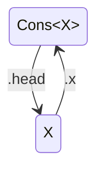
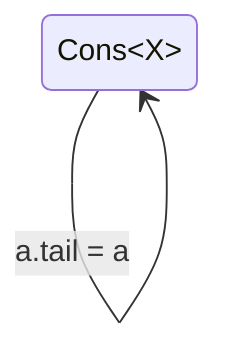

(Based on the template for Golang's [design doc TEMPLATE.md](https://github.com/golang/proposal/blob/master/design/TEMPLATE.md), part of [Golang's change proposal process](https://github.com/golang/proposal/blob/master/README.md))

# Proposal: Memory Cycle Checker

Author(s): Mike S.

Last updated: 2026-11-10

Discussion at https://github.com/temperlang/temper/issue/NNNNN.

## Abstract

Temper needs to translate well to languages whose runtimes do not have automatic garbage collection that is sound in the face of reference cycles.

This proposal outlines a compile-time memory cycle checker: for each class definition written in Temper, can that type be used (worst case) to construct a memory cycle which would leak memory in a runtime that only supports reference-counting for garbage collection.

## Background

[ASAP](https://www.cl.cam.ac.uk/techreports/UCAM-CL-TR-908.pdf) covers a lot of topics in memory management.

_Cyclic Reference Counting with Permanent Objects_ by Lins et al. explains a limitation of simple reference counting.


Languages like Python and Swift use reference counting extensively, and add affordances like Python's cycle collector, and in Swift's case, weak references and valgrind style tooling to detect leaks.


## Proposal

This proposal consists of these parts each of which has its own header below:

1. **`forbids` clause syntax**: extra syntax on type declarations including  `class`es, `interface`s, and type formal declarations.
1. **`class` cycle checks**: compile-time static checks for each `class` definition, the **class cycle checker**.
1. **`forbids` constraint checker**: compile-time checks on type bindings that they obey `forbids` clauses.
1. **A cycle test suite**: Including the examples below, a suite of test programs that fail and the error messages that should be produced along with similar programs that pass.
1. **Visualizations**: additions to the command line tool and in the REPL that aid in visualizing and repairing memory cycles by showing DOT graphs of how a memory cycle can be formed allowing quick identification of property chains and mutability that could change.
1. **Documentation**: documentation covering the rules in detail, motivation for target languages that don't have scanning GC, examples of what works and doesn't and how to change the one's that don't, and a coverage of topics like ownership, graph representation using façades.

## Rationale

Many programming languages have automatic garbage collection (GC). But that automatic garbage collection doesn't always deal well with cyclic data structures.  For example, C and C++ requires developers to pick one of a number of strategies to ensure deallocation: carefully pairing malloc and free instructions, associating allocations with block scopes during which the allocation is live, using a smart pointer type like a ref-counting pointer, allocating into an arena, etc. Python does use reference counting, but it has a secondary cycle collector that makes its memory management cycle-safe, but Python also relies on RAII-like patterns (resources held by a coroutine are freed on coroutine instance deallocation) that can be confused and delayed by reference cycles.

Simple reference counting semantics for Temper references is a sweet spot for high translatability. Without observable deallocation (no destructors with visible side-effects), target languages that assume scanning GC just work, and target languages that allow for reference counting can also be translated to.

And there is a style of programming, OCaml mostly immutable records, that is naturally acyclic.  Encouraging this style in Temper should mean that most code doesn't need to worry about memory management.  Those work because there is a natural ordering which allows proving absence of cycles: immutable members of an immutable record are older than the record.

This approach focuses the additional collection at mutable and generic types.  The more concrete the types, the more information the checker has to prove; types that layer well (this contains that but not vice versa) just work.

There are also a variety of fallback strategies if this proves hard to use:

- Scoped building idioms. Some mutable types like *ListBuilder* are mutable but short lived, so idioms like Kotlin `buildList { ... }` where the auto-allocated *ListBuilder* switches to a state where it is guaranteed always empty after control exits the `}`, can be exceptions to the rule.  The output *List* type needs to bpass the `forbids` constraint checker.
- Libraries for some apparently cyclic use cases like graphs based on adjacency tables.
- Weak references which can allow for parent pointers in AST representations without breaking use cases where the root pointer is strong and not held by an AST.

## Compatibility

This change will probably break existing code that uses `interface`s in ways that would allow a new implementation of the `interface` to refer back to a thing that holds the interface.

For an effectively `@imu` type, often specifying that the interface is `@imu` may allow working around this, but in other cases, extra `forbids` relationships may allow working around problems.

## Implementation

https://github.com/temperlang/acyclic-types is an experimental implementation of the type definition cycle checker.

The `forbids` operator is already in the operator table.
`forbids` should be allowed in `interface` and `class` definitions and so needs its own space in *TypeDefinition*.

The REPL visualizations would benefit from a dependency on a command line image display library like [imgcatr](https://github.com/SilinMeng0510/imgcatr).  Generating a `.dot` file (perhaps a Graphviz out-grammar could help), invoking `dot -Tpng` and then catting the resulting binary could help with showing cycle-participant graphs (also defined in the experiment) in error messages and in the REPL.

Draft documentation below.


## Testing

Kinds of tests:

Memory cycle checking is exclusively a frontend concern, so stage tests that capture error messages suffice for testing the static checks.

Testing image output in the REPL is important. Having a mode where visualizations output the text of the DOT visualization (or other), and so check the input content work.  A single end-to-end REPL or `temper build` test that uses a headless shell and screenshots might suffice to give confidence that visualizations make it through to the person behind the keyboard.  For non-sighted users, the DOT visualization should be sparse enough to read.

----

A simple cons-list that does not allow for cycles.

```ts
class Cons<T forbids Cons<T>>(
  public head: T,
  public tail: Cons<T>?,
) {}
```

A forbidden type since it violates `forbids Cons<T>`

```ts
Cons<Any>
```

Allowed types that obey `forbids Cons<T>`

```ts
Cons<String>
Cons<Cons<String>>
```


A variant of the cons-list that does allow for cycles as it misses the `forbids` clause.

```ts
class Cons<T>(
  public head: T,
  public tail: Cons<T>?,
) {}
```

If *X* is a constructed type like `class X(public var x: Cons<X>) {}` then this creates a cycle.



A variant of the cons-list that does allow for cycles as it allows for relinking tail.  There is no younger-than ordering principle.

```ts
class Cons<T forbids Cons<T>>(
  public head: T,
  public var tail: Cons<T>?,
) {}
```

Assuming there's some *X* that allows construction of a *Cons&lt;X&gt;*:



TODO: layered classes, nesting sealed interfaces based on exhaustive analysis, etc.

## Documentation

TODO

## Open issues (if applicable)

Are images in error messages broadly acceptable, or should those be in interactive mode only?
