# Proposal: Memory Cycle Checker

Author(s): Mike S.

Last updated: 2026-11-16

Status: Proposed

Discussion at https://github.com/temperlang/temper/issue/659

## Abstract

Temper needs to translate well to languages whose runtimes do not have automatic garbage collection that is sound in the face of reference cycles.

This proposal outlines a compile-time memory cycle checker: for each class definition written in Temper, can that type be used (worst case) to construct a memory cycle which would leak memory in a runtime that only supports reference-counting for garbage collection.

## Background

[ASAP](https://www.cl.cam.ac.uk/techreports/UCAM-CL-TR-908.pdf) covers a lot of topics in memory management.  Below we use its definition of *garbage collection* as automated runtime machinery which frees memory used by values.  Its definition includes mark-and-sweep garbage collectors which readers might think of first when they see "garbage collector," but it also includes reference counting.  Mark-and-sweep and other approaches like Python's reference counting augmented with a scanning cycle collector are collectively grouped under *scanning garbage collectors*.  Reference counting alone, by contrast, is a non-scanning approach to garbage collection; it never "scans" transitive reference relationships; deallocation decisions are based solely on local information: whether the count is zero.

_Cyclic Reference Counting with Permanent Objects_ by Lins et al. explains a limitation of simple reference counting.


Languages like Python and Swift use reference counting extensively, and add affordances like Python's cycle collector, and in Swift's case, weak references and valgrind style tooling to detect leaks.


## Proposal

This proposal consists of these parts each of which has its own header below:

1. **`forbids` clause syntax**: extra syntax on type declarations including  `class`es, `interface`s, and type formal declarations.
1. **`class` cycle checks**: compile-time static checks for each `class` definition, the **class cycle checker**.
1. **`forbids` constraint checker**: compile-time checks on type bindings that they obey `forbids` clauses.
1. **A cycle test suite**: Including the examples below, a suite of test programs that fail and the error messages that should be produced along with similar programs that pass.
1. **Visualizations**: additions to the command line tool and in the REPL that aid in visualizing and repairing memory cycles by showing DOT graphs of how a memory cycle can be formed allowing quick identification of property chains and mutability that could change.
1. **Documentation**: documentation covering the rules in detail, motivation for target languages that don't have scanning GC, examples of what works and doesn't and how to change the ones that don't, and a coverage of topics like ownership, graph representation using façades.

## Rationale

Many programming languages have automatic garbage collection (GC). But that automatic garbage collection doesn't always deal well with cyclic data structures.  For example, C and C++ requires developers to pick one of a number of strategies to ensure deallocation: carefully pairing malloc and free instructions, associating allocations with block scopes during which the allocation is live, using a smart pointer type like a ref-counting pointer, allocating into an arena, etc. Python does use reference counting, but it has a secondary cycle collector that makes its memory management cycle-safe, but Python also relies on RAII-like patterns (resources held by a coroutine are freed on coroutine instance deallocation) that can be confused and delayed by reference cycles.

Simple reference counting semantics for Temper references is a sweet spot for high translatability. Without observable deallocation (no destructors with visible side-effects), target languages that assume scanning GC just work, and target languages that allow for reference counting can also be translated to.

And there is a style of programming, OCaml mostly immutable records, that is naturally acyclic.  Encouraging this style in Temper should mean that most code doesn't need to worry about memory management.  Those work because there is a natural ordering which allows proving absence of cycles: immutable members of an immutable record are older than the record.

This approach focuses the additional collection at mutable and generic types.  The more concrete the types, the more information the checker has to reason about them; types that layer well (this obviously contains that but not vice versa) just work.

There are also a variety of fallback strategies if this proves hard to use:

- Scoped building idioms. Some mutable types like *ListBuilder* are mutable but short lived, so idioms like Kotlin `buildList { ... }` where the auto-allocated *ListBuilder* switches to a state where it is guaranteed always empty after control exits the `}`, can be exceptions to the rule.  The output *List* type needs to pass the `forbids` constraint checker.
- Libraries for some apparently cyclic use cases like graphs based on adjacency tables.
- Weak references can allow for parent pointers in AST representations without breaking use cases where the root pointer is strong and not held by an AST.

## Compatibility

This change will probably break existing code that uses `interface`s in ways that would allow a new implementation of the `interface` to refer back to a thing that holds the interface.

For an effectively `@imu` type, often specifying that the interface is `@imu` may allow working around this, but in other cases, extra `forbids` relationships may allow working around problems.

## Implementation

https://github.com/temperlang/acyclic-types is an experimental
implementation of the type definition cycle checker.

### Drop-order graphs

*acyclic-types* defines a kind of graph that herein we call a
*drop-order graph* (examples below) that is constructed to check
`class` and `interface` type declaration.  It always starts with the
type being checked, and for each backed property (properties that
correspond to memory containing a pointer to a things) we have an edge
to a node for that properties type.  And those nodes can have outgoing
nodes based on their type (rules below explain those for *Never*,
*Result*, nullable, and other builtin kinds of types).  There can be
multiple nodes in play for the same type definition; for example, a
`List<List<X>>` can point to a `List<X>` which can point to an `X`.
Abstract types are exploded out based on worst-case assumptions; type
parameter references based on analysis of their upper-bounds pruned by
forbids clauses (assuming *AnyValue* if there are no constraining
upper bounds), and interfaces based on possible subclasses.

The goal of a *drop-order graph* is to make it easy to identify the
potential for object-graph cycles.  There are multiple kinds of edges.
A can-be-a edge (`is?`) expresses that the origin type is assignable to
the destination type.  A `<=` points-to edge expresses that the origin can
point-to the destination via a property that is assigned once and in the
constructor before `this` is used as an rvalue. A simple `<` points-to
edge denotes any other points-to relationship.

If a cycle in the drop-order graph has no `<` edges, then there is
no contradiction: the born-after property holds among early-initialized
const property chains, so there's no problem.  If there is a cycle
involving `<` edges, then there is a problem: there is no guarantee
that there is a valid order in which values are dropped (deallocated);
for some value to be dropped, it would have to have been dropped before
it can be dropped.  That intuition meshes with the idea that a ref-count
cycle is a problem because you'd have to decrement the ref-count to zero
before it can reach zero via the rules of ref-counting.

### Outgoing drop-graph edges

A nullable type (postfix `?` type) node has a single outgoing edge to
the node for its non-nullable as a `<=` edge.  `Foo? -> Foo`.  A
`Foo?` property can point to a `Foo` or to the special `null` value
but we don't bother representing that `null` value with a node because
it points to nothing.

There is no value of a `Never` type that points to anything, so when building a
drop-order graph, a drop-order graph node for a type like `Never<Foo>` has no
outbound edges.  It's fine if a backed property with type `Never<Foo>?` just
points to a `Never<Foo>` node but it's also fine to optimize those out since
both non-nullable Never nodes and nulls are dead-ends.

`Result<Foo, Bar>` can point to a `Foo` or a `Bar` but as these are only valid
as return types, and not as property types, they should not show up in drop-order
graphs for types that do not have other serious problems.  Their outgoing edges
are `<=` edges.

A functional interface type may have `forbids` clauses that constrain what it
can close over, so functional interface types are just like other interface types.
They do not necessarily point to anything related to their input or return types.

We assume non-empty lists are possible (except for `List<Never<...>>`)
so a `List<Foo>` can point to a `Foo` via the `.0` (element 0) pseudo property.
Lists can have more than one element, but there's no need for repetitive edges;
an analysis optimistically assuming all lists are of length 1 is sufficient.
`List`s references to their elements are `<=` edges.

Likewise `Listed<Foo>` and `ListBuilder<Foo>` have an element 0 pseudo property
but it is non-const, a `<` edge.

`Mapped` and its subtypes have two outgoing edges to the key type and the value
type.  For `Map` the edges are `<=` edges.  For `Mapped` and `MapBuilder` they are
`<` edges.  Using the pseudo property names `.key` and `.val` should make drop-edge
graphs readable.

`String`, `StringBuilder`, the numeric types, booleans, string index types,
and the empty type need no outgoing edges.
They may internally have storage for bits, and the stringy types might have
backing arrays, but any content bottoms out on non-pointer bits so is ignorable
for the purposes of cycle checking.

For a type parameter reference, e.g. a `T` type corresponding to a `<T>` declaration,
there are two cases: `<T>` is declared `@imu` (deeply immutable) or it is not declared
`@imu`.  If it does not have `@imu` type metadata then it needs `can-be-a` edges to each
type node that exists and which fits its upper bounds.
If it is declared `@imu` then it needs outgoing `can-be-a` edges in the same way but only
to those nodes which are effectively-imu.

Similarly, interface type nodes (including `@fun` interfaces) have outgoing edges to
each node that is a type assignable to their type, filtered by `@imu`.

Non-sealed interface types (including `@fun` interfaces) have outgoing edges to
fictional class types (see `*Sub` types in examples below) that have a property
`x` that points back to the subject type.  That property might be pruned as below,
but its entered into the graph.  If the interface type has `@imu` then metadata then
the synthesized is a `<=` edge but is an `<` edge otherwise.

Both type parameter reference nodes and interface type nodes are
subject to edge pruning based on `forbids` clauses.  (See examples of
edge pruning below under test and examples.)

### Forbids

The `forbids` operator is already in the operator table.  `forbids`
should be allowed in `interface` and `class` definitions as well as
type formal definitions, so the data structures that track type
definitions generically should store a list of forbidden types.

### Visualization and debugging aid

The REPL visualizations would benefit from a dependency on a command
line image display library like
[imgcatr](https://github.com/SilinMeng0510/imgcatr).  Generating a
Graphviz (`.dot`) or Mermaid file (perhaps am out-grammar could help),
invoking the shell to convert to an image and then displaying the
resulting image could help with showing drop-order graphs in error
messages and in the REPL.  (The web playground already supports
Mermaid rendering using Mermaid JS library support) A MessageTemplate
that identifies an output as inlinable image output could allow
optional inlining if in interactive mode and the user has not
expressed a preference for accessible textual content.

### Cycle Checking algorithm

Cycle checking is done per `class` declaration because other type
declarations do not allocate storage.  Forbids checking is done per
type phrase; every type that appears in a node's AST.  The former
need not be cached because each `class` is only considered once; the latter
can be aggressively cached as long as care is taken not to use cached
state from before a type declaration is modified by metaprogramming.

```temper
// Pseudocode
sealed interface EdgeKind {
  /** The type the edge points to. */
  type: Type2;

  @operator("==")
  eq(that: EdgeKind): Boolean;

  toString(): String;
}

class HasAEdgeKind(
  /** The type the edge points to. */
  public type: Type2,
  /**
   * True iff the property is non-var and initialized before
   * the `this` of its container is used as an rvalue.
   */
  public early: Boolean,
  /** Non-normative.  Let's us reconstruct property chains. */
  public propertyHint: String,
) extends EdgeKind {
  @operator("==")
  public eq(that: EdgeKind): Boolean {
    that is HasAEdgeKind && this.type == that.type && this.early == that.early
  }

  public toString(): String {
    "${if (early) { "<=" } else { "<" }} ${propertyHint} : ${type}"
  }
}

class CanBeAEdgeKind(
  /** The type the edge points to. */
  public type: Type2,
) extends EdgeKind {
  @operator("==")
  public eq(that: EdgeKind): Boolean {
    that is CanBeAEdgeKind && this.type == that.type
  }

  public toString(): String { "is? ${type}" }
}

@auto("==")
class NodeKey(
  public type: Type2,
  /**
   * Type parameters like `<@imu T>` can specify they bind to an intersection of types but
   * only effectively-imu variants of that intersection.
   *
   * Propagate that is-imu bit so that we can use `<=` outgoing edges from them.
   * This ends up affecting the has-a edges synthesized for worst-case interfaces.
   */
  public imuOverride: Boolean,
) forbids DropOrderGraph {}

class DropOrderNode(
  /**
   * Auto-assigned when added to the graph.
   * Serially assigned starting at 0 so suitable for arrays that associate by index.
   */
  public serialNo: Int32,
  public key: NodeKey,
) forbids DropOrderGraph {}

class DropOrderEdge(
  public origin: NodeKey,
  public destination: NodeKey,
  public kind: EdgeKind,
) forbids DropOrderGraph {}

class DropOrderGraph {
  // Internal state elided.

  public nodeForKey(key: NodeKey): DropOrderNode;

  public addEdge(origin: DropOrderNode, kind: EdgeKind, dest: DropOrderNode): Void;

  /** In serialNo order. */
  public allNodes(): List<DropOrderNode>;

  public outgoing(key: NodeKey): List<DropOrderEdge>;
}

class ForbidMismatch(
  public forbidden: Type2,
  public transitivelyHas: Type2,
  /** The shortest chain of property hints via which transitivelyHas is reachable. */
  public viaPath: List<String>,
) {}

class CycleCheckProblems(
  public graph: DropOrderGraph,
  public cycles: List<Cycle>,
  public forbidMistmatches: List<ForbidMismatch>,
) {}

let checkClassTypeForPotentialReferenceCycles(classTypeShape): CycleCheckProblems {
  let graph = new DropOrderGraph();

  // The type of `this` in one of the `class`'s methods.
  // If `classTypeShape` is `C` and has type formals `<T, U>`
  // then mainType is `C<T, U>`.
  let mainType = MkType2(classTypeShape)
      .bindings(classTypeShape.typeFormals.map { t -> MkType2(t).get() })
      .get();
  let mainTypeKey = new DropOrderKey(mainType, false);

  // We need to navigate from there to check for cycles once
  // we've added edges and pruned them.
  let mainNode = graph.nodeForKey(mainTypeKey);

  // Build out the graph.
  //
  // First, we build out all has-a edges.
  //
  // Second, we'll link can-be-a edges and potentially add nodes for
  // super-types, but those nodes rarely add new has-a relationships because
  // previously unseen super-types are usually non-class types which have
  // no properties.
  // There are two exception to the rule:
  // 1. When an `interface` type is `sealed`, and some of its
  //    direct sub-types are `class` types.  We add can-be-a edges to
  //    the direct sub-types and note that they may have properties.
  // 2. When a <T> can-be-a <U> and the <U> has a class type as an upper-bound,
  //    the outer loop repeats.  This is a rare case as class types are not
  //    often useful upper bounds.
  //
  // Third, and only after we've converged on all the edges do we prune edges
  // using `forbids` relationships.
  //
  // Fourth, we build a list of cycles by navigating from the mainNode.
  // We do not look for cycles from other nodes, even if they are class nodes.
  // They will get checked when it's their turn.
  //
  // Fifth, we check that the class definition respect its own (including inherited)
  // `forbids` clauses.  We scan super-types and contextualize super-type `forbids`
  // clauses, and collect them.  Then we check that each backed propery's type does
  // not point to anything forbidden either by having a sufficient forbids type or
  // by being a class type that does not in fact point to anything forbidden, or
  // being a sealed interface type each of whose direct sub-types falls into one of
  // the above categories.

  let needsHasAEdges = new Deque<DropOrderKey>();
  needsHasAEdges.add(mainTypeKey);
  let hasAEdgesDone = new SetBuilder<DropOrderKey>();
  while (!needsHasAEdges.isEmpty) {
    // Step I
    while (true) {
      let key = needsHasAEdges.popOrNull();
      if (key == null) {
        break
      } else {
        if (hasAEdgesDone.has(key)) {
          continue;
        }
        hasAEdgesDone.add(key);

        // backedPropertiesOf also lists the pseudo-properties per the
        // rules below that indicate that `Never` types have no properties
        // and lists `List` types as having a `.0` pseudo property.
        for (let p of backedPropertiesOf(key.type)) {
          // For a `class Foo<T>(public myProp: List<T>)`
          // the type of .myProp in context of `Foo<String>` is `List<String>`.
          //
          // Our analysis is the same even if all nullable property types and
          // TypeFormal upper bounds are replaced with the corresponding non-nullable
          // type, so we just avoid bloating graphs and sets
          // (and the visual representation of drop-order graphs) with nodes
          // for nullable types by using `nonNullableOf`.  It just returns the
          // non postfix-`?` type for one that has it, or the type given otherwise.
          let pTypeInContext = nonNullableOf(propertyTypeInContext(p, type));
          let isEarly = key.imuOverride || isEarly(p);
          if (!hasAEdgesDone.has(pTypeInContext)) {
            needsHasAEdges.add(pTypeInContext);
            needExplodeSupers.add(pTypeInContext);
          }
          let pTypeKey = new DropOrderKey(pTypeInContext, key.imuOverride);
          let pNode = graph.nodeForKey(pTypeKey);
          let pHint = propertyHintFor(p);
          let kNode = graph.nodeForKey(key);
          graph.addEdge(kNode, new HasAEdgeKind(pTypeInContext, isEarly, pHint), pNode);
        }
      }
    }

    // Step II. Add can-be-a edges.
    let needExplodeSupers = new Deque<DropOrderKey>();
    for (node of graph.allNodes()) {
      needExplodeSupers.add(node.type);
    }
    let exploded = new SetBuilder<DropOrderKey>();
    let fakes = new SetBuilder<DropOrderNode>();
    while (true) {
      let key = needExplodeSupers.popOrNull();
      if (key == null) {
        break;
      } else {
        let type = key.type;
        if (isClassType(type)) { continue; }
        if (exploded.has(key)) { continue; }
        exploded.add(key);
        if (isInterfaceType(type)) {
          if (isSealedInterfaceType(type)) {
            // Add can-be-a relationships.
            // We're just listing out the direct subtypes, not their subtypes transitively.
            // If type is `I<List<String>>` and I is based on `sealed interface I<T>` and
            // `class C<U> extends I<List<U>>` then we use our backwards projection to
            // come up with `C<String>`
            for (let subType of directContextualizedSubTypesOf(type)) {
              let subKey = new DropOrderKey(subType, key.imuOverride);
              if (isClassType(subType)) {
                if (!hasAEdgesDone.has(subKey)) {
                  // First re-enter outer loop condition described above.
                  needsHasAEdges.add(subKey);
                }
              } else {
                needExplodeSupers.add(subKey);
              }
              let kNode = graph.nodeForKey(key);
              let subNode = graph.nodeForKey(subKey);
              graph.addEdge(kNode, new CanBeAEdgeKind(subType), subNode);
            }
          } else {
            // Construct a worst-case class type specifically
            // for mainType that extends type.
            // This is one of the reasons that we don't try to cache
            // drop-graphs for one type that happen to explode out things for
            // other class-types.

            let fakeClassType = constructFakeClassType(
              type, // that it extends.  Also type's definitions's name is used as a hint.
              mainType, // type for its property,
              key.imuOverride,
            );
            let fakeKey = new DropOrderKey(fakeClassType, key.imuOverride);

            let kNode = graph.nodeForKey(key);
            let fakeNode = graph.nodeForKey(fakeKey);
            fakes.add(fakeNode);
            graph.addEdge(kNode, new CanBeAEdgeKind(fakeClassType), fakeNode);
            let isEarly = key.imuOverride || isImu(type);
            let pHint = ".x";
            graph.addEdge(fakeNode, new HasAEdgeKind(mainType, isEarly, pHint), mainNode);
            hasAEdgesDone.add(fakeKey);
          }
        } else if (isTypeFormalReference(type)) {
          let upperBounds = type.upperBounds;
          le isImuRef = isImu(type);
          let boundKeys = if (upperBounds.isEmpty) {
            [new DropOrderKey(anyValueType, isImuRef)]
          } else {
            upperBounds.map { ub => new DropOrderKey(ub, isImuRef) }
          }
          // WARNING: fanning out like this is like unioning,
          // but the semantics of type formal upper bounds
          // are intersection.
          // TO DISCUSS: Should nodes store intersections of types instead of one-type?
          // If so, then `forbids` clauses would be unioned over the types' clauses.
          for (let boundKey of boundKeys) {
            let kNode = graph.nodeForKey(key);
            if (!hasAEdgesDone.has(boundKey)) {
              needsHasAEdges.add(boundKey);
            }
            let boundNode = graph.nodeForKey(boundKey);
            graph.addEdge(kNode, new CanBeAKind(boundKey.type), boundNode);
          }
        }
      }
    }
  }

  // Step III. Now prune out fake class's has-a edges based on `forbids` relationships.
  if (!fakes.isEmpty) {
    // Propagate forbids relationships across graph nodes.
    // Something is "always forbidden" if it is forbidden across every incoming edge.
    // If mainType is forbidden at a fake class type node,
    // then sever the has-a edge between the fake class type and its fake property.

    @auto("==")
    class ForbidsFreq(
      public forbids: Type2,
      public always: DenseBitVector,
      public sometimes; DenseBitVector,
    ) {}

    class Propagated(public to: DropOrderKey, public from: DropOrderKey?) {}

    let forbidden = new MapBuilder<Int32, ListBuilder<ForbidsFreq>>();
    let q = new Deque<Propagated>();
    q.add(new Propagated(mainTypeKey, null));
    // TODO: Graph propagation using queue that fans out as long as things are
    // changing.  ForbidsFreq.always bitset has bits corresponding to node serialNo's
    // set when that node propagates always for the forbidden type, and the bit set
    // in sometimes when it propagates sometimes.
    // For a given forbidden type, a node propoagates always when at least one bit
    // is set in the always bitset and no bits are set in the sometimes bitset.
    // It propagates sometimes when a bit is set in the someimes bitset.
    // When a node changes whether it propagates or what it propagates for any forbidden
    // type, it needs to enqueue a propagation from it to each of its followers in the
    // graph.

    // TODO: Once graph propagation is done, we check each fake node, and check whether
    // its type or a super-type is always forbidden, and if so, mark its outgoing has-a
    // edge as pruned.
  }

  // Step IV.
  // TODO: Walk the graph from main looking for cycles involving non-pruned edges,
  // which include at least one `<` edge.
  // Each such cycle should be put on a list, and if the list is non-empty, the
  // consumer of the CycleCheckProblems return value can figure out how to turn
  // that into compiler error messages and visualizations.

  // Step V.
  // TODO: If the declaration has forbids declarations, and we didn't fail the cycle
  // check above, walk from the main node and collect all transitive has-a types
  // reachable via non-pruned edges.
  // Then check that none of them or their sub-types fall within a forbids declaration.
  // Make any mismatch available via the return value so that the caller
  // can give recommendations on what not to forbid, or how to modify types under
  // the user's control, or where to add forbids clauses.
}
```

## Testing and examples

Kinds of tests:

Memory cycle checking is exclusively a frontend concern, so stage tests that capture error messages suffice for testing the static checks.

Testing image output in the REPL is important. Having a mode where visualizations output the text of the DOT visualization (or other), and so check the input content work.  A single end-to-end REPL or `temper build` test that uses a headless shell and screenshots might suffice to give confidence that visualizations make it through to the person behind the keyboard.  For non-sighted users, the DOT visualization should be sparse enough to read.

### Example: Cons list variants

A simple cons-list that does not allow for cycles.

```ts
class Cons<T forbids Cons<T>>(
  public head: T,
  public tail: Cons<T>?,
) {}
```

A forbidden type since it violates `forbids Cons<T>`

```ts
Cons<Any>
```

Allowed types that obey `forbids Cons<T>`

```ts
Cons<String>
Cons<Cons<String>>
```


A variant of the cons-list that does allow for cycles as it misses the `forbids` clause.

```ts
class Cons<T>(
  public head: T,
  public tail: Cons<T>?,
) {}
```

If *X* is a constructed type like `class X(public var x: Cons<X>) {}` then this creates a cycle.

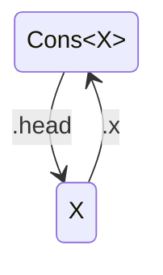

A variant of the cons-list that does allow for cycles as it allows for relinking tail.  There is no younger-than ordering principle.

```ts
class Cons<T forbids Cons<T>>(
  public head: T,
  public var tail: Cons<T>?,
) {}
```

Assuming there's some *X* that allows construction of a *Cons&lt;X&gt;*:

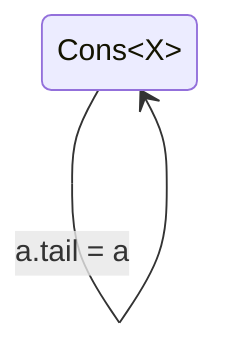

### Implicit cycles via closure conversion can be a problem.

```ts
let outer(wantEven: Boolean, i: Int32): Fn(Int32): Boolean {
  // Two coreferential nested functions that close
  // over the same state.
  let isEven(j: Int32 = i): Boolean {
    j == 0 || isOdd(j - j.sign())
  }
  let isOdd(j: Int32 = i): Boolean {
    j != 0 && isEven(j - j.sign())
  }

  // Just a declaration that points to a function.
  // isEven and isOdd don't close over it, but if they
  // did, that'd be cyclic.
  var f = if (wantEven) { isEven } else { isOdd };

  f
}
```

JavaScript has a proper cycle-scanning garbage collector, but here's the
JS equivalent with [closure conversion] done to show which problems can
be avoided and which cannot.

Here's one way to do closure-conversion in JavaScript.

```ts
// Naive rewrite.
function outer(wantEven, i) {
  // Original functions renamed and with references to closed-over
  // state rewritten to point to an extra closureRecord input.
  function isEvenConverted(closureRecord, j = closureRecord.i) {
    return j === 0 || closureRecord.isOdd(j - Math.sign(j));
  }
  function isOddConverted(closureRecord, j = closureRecord.i) {
    return j !== 0 && closureRecord.isEven(j - Math.sign(j));
  }

  // Declare the original names, and a closure record.
  // Curry the converted functions with the shared record to
  // get function values that have the same signature and semantics
  // as the originals.
  const sharedClosureRecord =
    {
    };
  const isEven = isEvenConverted.bind(sharedClosureRecord);
  const isOdd = isOddConverted.bind(sharedClosureRecord);
  // Initialize the closure record.
  sharedClosureRecord.isEven = isEven;
  sharedClosureRecord.isOdd = isOdd;
  sharedClosureRecord.i = i;

  let f = wantEven ? isEven : isOdd;

  return f;
}
```

This rewrite preserves the semantics of the original, and achieves
the goal of closure conversion
(function values internally reference only top-levels and inputs),
but it leads to this object graph:

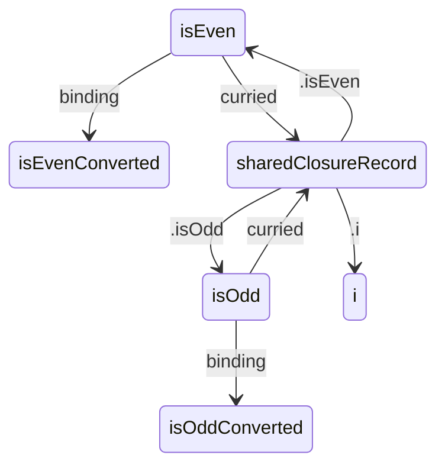

Notice the cycles: `isEven` points to `sharedClosureRecord` points back to `isEven`
and similarly for `isOdd`.

Here's an alternative, where named function declarations are not pre-computed
in `sharedClosureRecord`.  This approach is allowable in Temper because Temper
does not allow testing function reference identity; the fact that `isEven` bound
locally is not the same function value that `isOdd` calls recursively does not
matter to the semantics.  Function binding is side-effect free, so when and how
often it happens does not matter.

```patch
-// Naive rewrite.
+// Rewrite that allows coreferential named functions.
 function outer(wantEven, i) {
   // Original functions renamed and with references to closed-over
   // state rewritten to point to an extra closureRecord input.
   function isEvenConverted(closureRecord, j = closureRecord.i) {
     return j === 0 || closureRecord.isOdd(j - Math.sign(j));
   }
   function isOddConverted(closureRecord, j = closureRecord.i) {
     return j !== 0 && closureRecord.isEven(j - Math.sign(j));
   }

   // Declare the original names, and a closure record.
   // Curry the converted functions with the shared record to
   // get function values that have the same signature and semantics
   // as the originals.
   const sharedClosureRecord =
     {
+      get isEven() { return isEvenConverted.bind(sharedClosureRecord); };
+      get isOdd() { return isOddConverted.bind(sharedClosureRecord); };
     };
   const isEven = isEvenConverted.bind(sharedClosureRecord);
   const isOdd = isOddConverted.bind(sharedClosureRecord);
   // Initialize the closure record.
-  sharedClosureRecord.isEven = isEven;
-  sharedClosureRecord.isOdd = isOdd;
   sharedClosureRecord.i = i;

   let f = wantEven ? isEven : isOdd;

   return f;
 }
```

Changing binding named function declarations on demand leads to this object graph,
which lacks cycles.

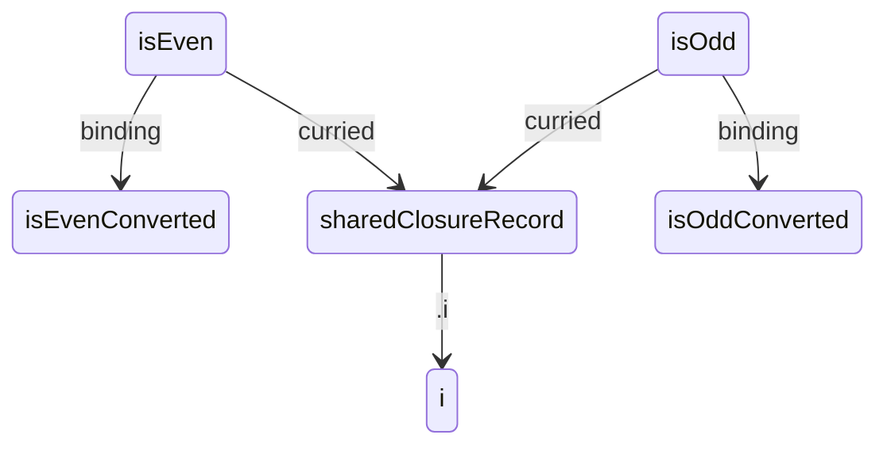

But if `var f`, the conditional function pointer,
was referenced by a converted inner function, then we would be in trouble again.
In the case where `f` points to `isEven`, we have this diagram.

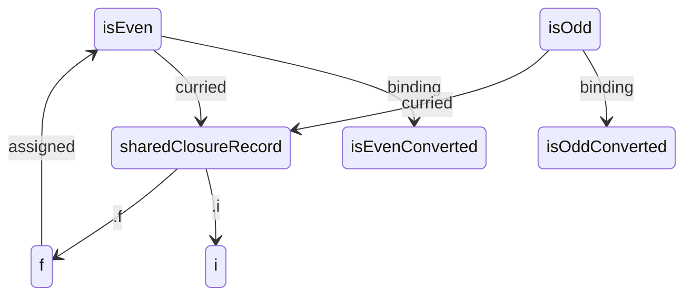

Rule: any function that closes over a local variable whose type is
either a function type that accepts that function
(pre-closure-conversion), or a super-type (*AnyValue*, *AnyValue\?*,
or that function type nullable) must be forbidden.

Similarly, if a function's type is reachable via assignment to a class instance field.

```ts
class Box<T forbids Box<T>>(public t: T) {}

let outer(): Void {
  let box: Box<fn: Void>;

  let f(): Void {
    box.t();
  }

  box = new Box(f);

  f();
}
```

To check this, the best way is to simulate closure conversion with virtual, ad-hoc types.
`outer` includes a closure, so generate an ad-hoc class type for its closure record, and
another for each closure and turn the checkers loose on them.

```ts
class ClosureRecord#123(public box: Box<fn: Void>()) {}

class BoundFunction#124(public boundParam0: ClosureRecord#123) extends fn: Void {}
```

Now, the reasoning about what closure conversion could do becomes apparent,
and, since `class Box` forbids `<T>` from referring to `Box<T>`, the error analysis
should conclude that the responsibility for the problem is in the combination
of the closure record and the bound function, not in the definition of `Box`.

[closure conversion]: https://matt.might.net/articles/closure-conversion/

### Forbids checking is contextual

```ts
class C<T>(
  public strings: List<String>,
) forbids List<T> {}

// Error: C<String> forbids List<String> but has a backed property that can
// point to a List<String>
let f(c: C<String>): Void {}

// Error: C's <T> binds to U but U does not forbid List<U>
let g<U>(c: C<U>): Void {}

// Ok: C's <T> binds to V which has compatible forbids
let h<V forbids List<V>>(c: C<V>): Void {}
```

This slight variant of it solves the problem in the class declaration.
Should Step V of the cycle checker algo realize that one of its forbids
can be parameterized to a super-type of one of its points-to types?
If so, we can avoid this at class check time and then rely on just checking
the validity of types like `c: C<String>` and sufficiency of forbids like `<U>`
mssing a forbid of String when it is used in `C<U>`.

```ts
class C<T forbids String>(
  public strings: List<String>,
) forbids List<T> {}
```

### Sealed interfaces

Interfaces are hard to reason about, but for sealed interfaces we can reason
about each direct sub-type individually without worrying about separately
constructed sub-types.

```ts
interface I {}

class C(
  public i: I
) {}
```

That fails because other code could theoretically construct a subtype
of I that allows for a cycle.

```ts
class ISub(public var c: C?) extends I {}

do {
  let isub = new ISub(null);
  let c = new C(isub);
  isub.c = c;
  // Now there's a cycle from c -> isub -> c
}
```

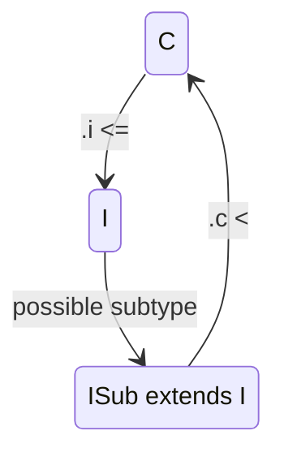

Here, the contradiction is *C* has to be less than itself because of the
`var` reference on the possible subtype of *I*.

But with `sealed interface`s, there are no *possible* subtypes that require
worst-case analysis; only the actual subtypes declared in the same module,
and their subtypes.

Here's an analogous case, *D* which points to an instance of a sealed interface, *J*.

```ts
class D(public j: J) {}

sealed interface J {}

class J1(public var s: String) extends J {}
class J2(public var n: Int64) extends J {}
class J3(public d: D?) extends J {}
```

Instead of having possible subtype relationships, we explode out all known variants.

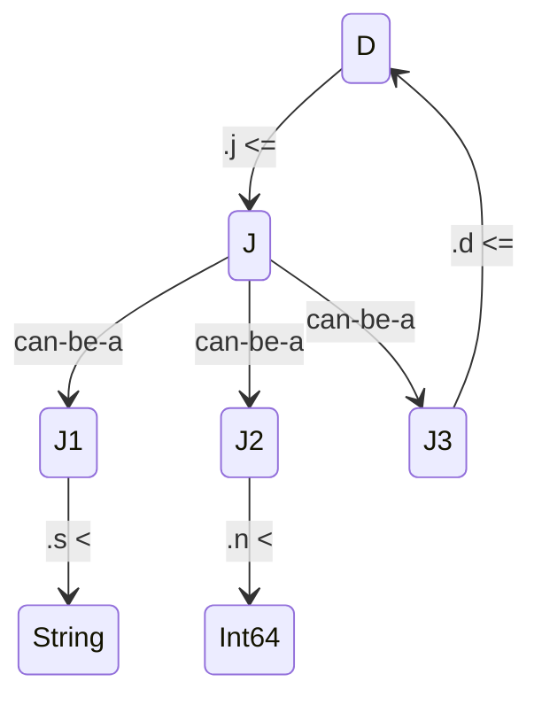

There's no contradiction.  Even though *J3* can point to a *D* and
vice versa, they are both via early, non-var properties which allows
for the temporal order property.  The cycle includes only `<=`
relationships, so there is no contradiction in the destructs-before
ordering.

### Forbidding interfaces

Sometimes we need `interface`s that aren't sealed and yet which we
collect over time.

For example, in a plugin module, we might want a universally extensible
interface.

```ts
class Messager(public subject: String) {
  private plugins: ListBuilder<MessagePlugin> = new ListBuilder<MessagePlugin>();

  public register(plugin: MessagePlugin): Void {
    plugins.add(plugin);
  }

  public printMessages(): Void {
    for (let plugin of plugins.toList()) {
      console.log(plugin.getMessage(subject));
    }
  }
}
```

But if anyone can construct a *MessagePlugin* subtype that refers back to
the *Messager* that owns them, then cycles are unavoidable.

```ts
interface MessagePlugin forbids Messager {
  getMessage(subject: String): String;
}
```

Here, the `forbids` clause on the `MessagePlugin` establishes that
its author restricts subtypes of it from pointing to a *Messager*:
*Messager* owns plugins, plugins don't own any *Messager*.

If a plugin author tried to do this then that would be a cycle type
definition checker error.

```ts
class BadMessagePlugin(var messagers: List<Messager>) extends MessagePlugin {}
```

Here, the drop-order graph would look like this:

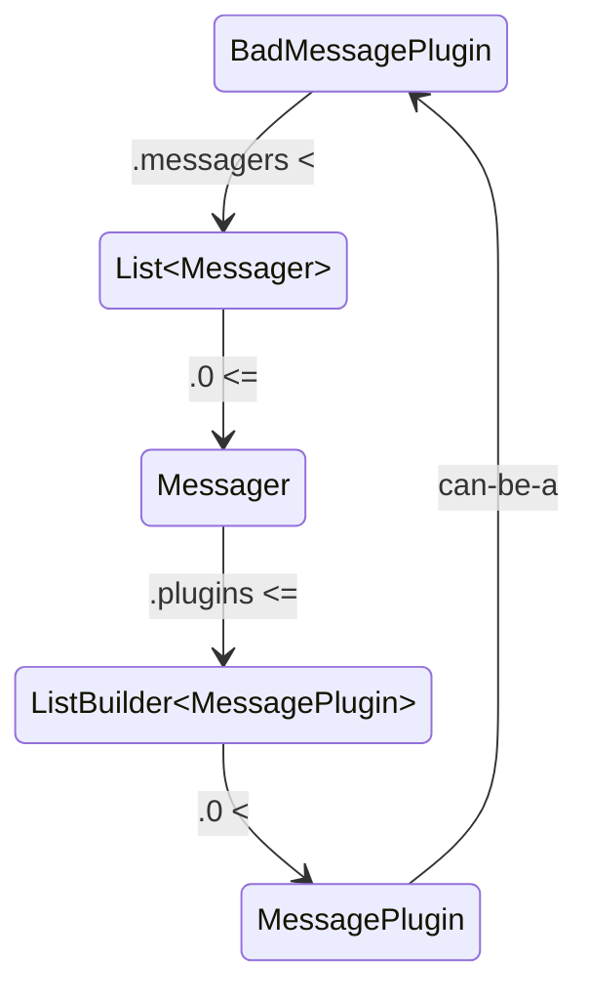

But *BadMessagePlugin* inherits a `forbids Messager` clause from its
supertype, so the edges `.messagers <` and `.0 <=` are illegal.

We're also allowed to use that fact to approve the *Messager* type.
We initially construct a drop-order graph that looks very similar,
but starting from *Messager* instead of *BadMessagePlugin*.

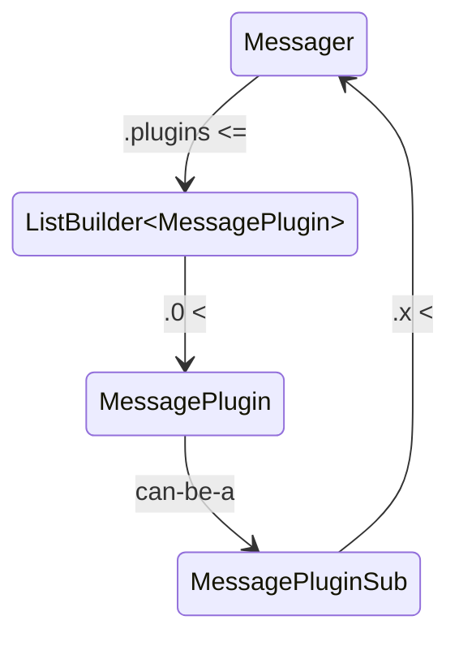

But we know our worst-case constructed *MessagePluginSub* is forbidden from
pointing (transitively) to *Messager*, so we can prune (see ❌ notation)
any of its outgoing edges that eventually lead to *Messager*.

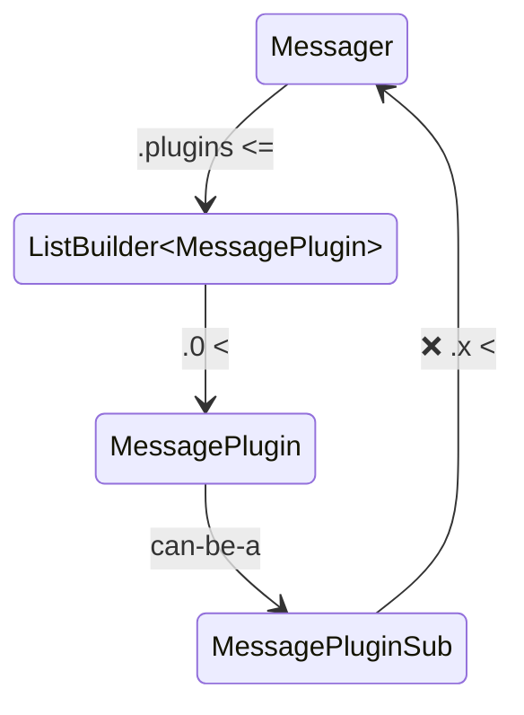

With those edges eliminated, we have this drop-order graph which is what is searched
for contradictory cycles starting at the subject, *Messager*.  No contradictions are found.

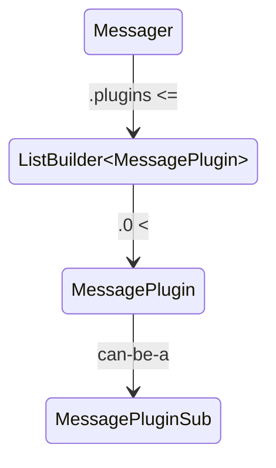

We also allow `forbids` clauses on `class`es, but since we know the actual backed
properties or every `class`, and Temper `class`es cannot have sub-types they are
less useful, except perhaps to document commitments not to evolve the `class` to
point to things in future versions.


## Scope bounded exceptions to the rule

```ts
let combine<T forbids List<T>>(a: List<T>, b: List<T>): List<T> {
  buildList { (builder) =>
    builder.addAll(a);
    builder.addAll(b);
  }
}
```

Here, the type formal `<T>` forbids `List<T>` but not `ListBuilder`.  The fact that
it uses a `ListBuilder` internally is an implementation detail that we might not
want to commit to forbidding, though, in this case, it's not problematic.

Can we use a `ListBuilder` or something equivalent internally?

What if we blessed certain classes as having a life-cycle where, if they progress
through their life-cycle, they are guaranteed not to participate in memory cycles.

Here's an example of how that might work in practice.

```ts
// After release, can point to nothing that might point back to it,
// and enters a zombie state where no new mutations can cause now
// back pointer paths.
interface PointsToNothingAfterRelease {
  release(): Void;
}


class LimitedTimeListBuilder<T> extends PointsToNothingAfterRelease {
  private released: Boolean = false;

  public add(el: T): Void {
    if (released) { return }
    ...
  }
  public addAll(els: Listed<T>): Void {
    if (released) { return }
    ...
  }

  public toList(): List<T> { ... }

  public release(): Void {
    // Flips bit so `add`s become no-ops.
    released = true;
    // Clears underlying content
    ...
  }
}

@inlineUnrealizedGoal
let buildList<T forbids List<T>>(f: Fn(LimitedTimeListBuilder<T>): Void): List<T> {
  let b = new LimitedTimeListBuilder<T>();
  let ls: List<T>;
//try {
  f(b);
  ls = b.toList();
//} finally {
  b.release();
//}
  ls
}
```

Note, this *buildList* idiom could be improved by following on an
initiative to add `this` as inputs to block lambdas.

When a local declaration has a type that is a sub-type of *PointsToNothingOnRelease*,
and it is const, and all paths downstream of its initializers lead to
a `.release()` of it (or of a variable that aliases it (possibly via `notNull(...)`))
then we can forego forbids-checking its type.  This doesn't solve the problem of
delegating building a list by passing the builder on.


## Documentation

### New reference topic: Temper memory model

Temper needs to work in languages that do not have scanning garbage
collectors.  It needs to be able to prove that type definitions do not
lead to pointer reference cycles that prevent reference counting
pointers from deallocating memory when it's no longer useful to the
program.

_Cyclic Reference Counting with Permanent Objects_ by Lins et
al. explains a limitation of simple reference counting.


Temper provides two main mechanisms to allow for flexibility in
defining types while preventing memory leaks:

- A \[memory cycle checker\]\[snippet/memory-cycle-checker\] checks
  type definitions obey points to rules.
- Type definitions have \[`forbids` clauses\]\[snippet/forbids-clause\]
  which allow constraining what abstract types can point to.

\[inline memory-cycle-checker topic here]
\[inline forbids-clause topic here]

### New reference topic: Memory cycle checker

Temper's *memory cycle checker* checks each `class` declaration to
ensure that it: cannot point to itself via a chain of property
lookups.  In Temper, `interface`s can specify that subtypes need to
have properties but do not specify memory to hold pointers; only
`class`es do that.

If you write `class`es like OCaml records, things should just work:
concrete types that are shallowly immutable records that are
initialized at construction just work because of the *birth order principle*.

```ts
export class StringTree(
  public s: String,
  public left: StringTree?,
  public right: StringTree?,
) {}

export let myStringTree: StringTree = {
  s: "root",
  left: {
    s: "left leaf",
    left: null,
    right: null,
  },
  right: {
    s: "right leaf",
    left: null,
    right: null,
  },
};
```

That `class` definition refers to itself recursively but it cannot
have a memory cycle because each node is either `null` (which points
to nothing) or is older than the node that points to it.
That means that there is a well-known deallocation order: the root
will reach a reference count of zero and be eligible for deallocation
before its left and right, and when it is deallocated, its children's
reference counts will be decremented.

Sometimes types are naturally cyclic.  A graph consisting of *node*s and
*edges* might need to present an interface as-if nodes referred to
edges which could validly point back to that node.  "As-if" reference
does not require internal use of cyclic references.  Sometimes a managing
object can own pointers on behalf and use computed properties to present
a cyclic façade.

```ts
// Facades point to the owner but because they're
// created on demand, the owner does not point back.
// They use computed properties to present the state
// stores in the owner object as a convenient bundle.
class Node(
  private owner: Int32Graph,
  private nodeIndex: Int32,
) {
  public get value(): Int32 {
    owner.getNodeValue(nodeIndex)
  }
  public get outgoing(): List<Edge> {
    owner.getOutgoing(nodeIndex)
  }
  public get incoming(): List<Edge> {
    owner.getIncoming(nodeIndex)
  }
}

class Edge(
  private owner: Int32Graph,
  private fromIndex: Int32,
  private toIndex: Int32,
) {
  public get fromNode(): Node {
    owner.getNode(fromIndex)
  }
  public get toNode(): Node {
    owner.getNode(toIndex)
  }
}

// An adjacency table is a way of representing
// a complex a graph using a table where each
// row captures what is adjacent to one node.
class AdjEntry(
  public value: Int32,
  // These ints correspond to adjacent nodes.
  public outgoing: ListBuilder<Int32>,
  public incoming: ListBuilder<Int32>,
) {}


/** Stores ints at nodes and edges. */
export class Int32Graph {
  private adjacencyTable = new ListBuilder<AdjEntry>();

  // Adding nodes and edges would fill in that tables,
  // and could return facades that allow navigating the
  // graph.

  public getNode(index: Int32): Node {
    new Node(this, index)
  }

  public getNodeValue(index: Int32): Int32 {
    adjacencyTable[index].value
  }

  public getIncoming(index: Int32): List<Edge> {
    adjacencyTable[index].incoming.map { (i): Edge =>
      new Edge(this, i, index)
    }
  }

  public getOutgoing(index: Int32): List<Edge> {
    adjacencyTable[index].outgoing.map { (i): Edge =>
      new Edge(this, index, i)
    }
  }
}
```

The points-to relationships among these types are shown in this diagram.

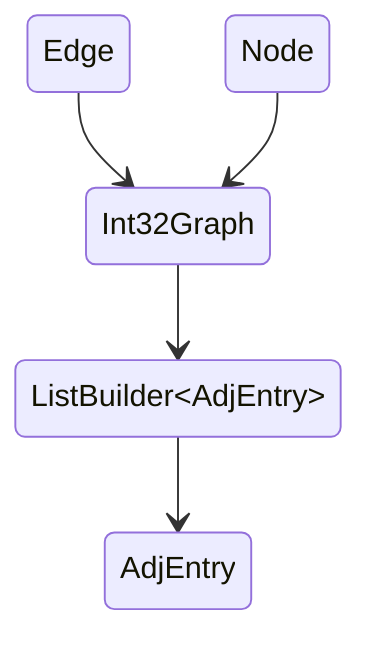

The façade types are constructed on demand, so they can point to the graph
object but are never pointed to by it and do not point to each other.

See \[`forbids` clauses\]\[snippet/forbids-clause\] for how this graph
might be made generic.


### New reference topic: `forbids` clauses

Inputs with types like `interface I` and `<T>` can have values of many
different concrete types assigned to them.  This means abstract types and
type variables enable many ways to produce reference cycles.  Without
same way to constrain them, they would be largely unusable in a language
that allows mutation, and disallows reference cycles.

```ts
do {
  let ls = new ListBuilder<AnyValue>();
  ls.add(ls);  // ls points to itself.
}
// FAILS: ListBuilder<T> forbids ListBuilder<AnyValue>
```

With `interface` types, it is often possible to construct a subclass
that points back to a class that uses the interface type for a backed property.

```ts
export interface I {}

// Each C points to I
export class C(public i: I) {}

// Some other library could define this class that points back.
export class IPointsBack(var c: C?) extends I {}

do {
  let myI = new IPointsBack(null);
  let c = new C(myI);
  // The birth order principle does not apply because IPointsBack uses `var`.
  myI.c = c;
}
// FAILS
```

If you can, `sealed interface`s allow the memory cycle checker to avoid
constructing worst-case implementations of interface types.

But sometimes an `interface` is meant to allow external extensions.
One strategy for producing code that passes the memory cycle checker
is to layer types based on ownership and use `forbids` to enforce that.

```ts
// MessageMaker logs a message, and allows for extension via an interface.
export class MessageMaker(public greeted: String) {
  // helpers is mutable; anyone can implement a Helper and add to it.
  public helpers: ListBuilder<Helper> = new ListBuilder<Helper>();

  public sayMessage(): Void {
    var message = "Hello, ${greeted}!";
    for (let helper of helpers.toList()) {
      message = helper.modify(message);
    }
    console.log(message);
  }
}

// If a Helper could point back to a MessageMaker
// then there'd be no-way to compile this library without
// knowing about subclasses of `interface Helper` in all
// the libraries that could implement it.
export interface Helper
// This forbids clause means that every type assignable to
// a variable with type Helper must have the property that
// it does not (transitively) point to a MessageMaker.
forbids MessageMaker {
  modify(s: String): String;
}

do {
  class ReversingHelper extends Helper { // reversing "helper"
    public modify(s: String): String {
      var idx = s.end;
      let sb = new StringBuilder();
      while (idx > String.begin) {
        var before = s.prev(idx);
        sb.appendBetween(s, before, idx);
        idx = before;
      }
      sb.toString()
    }
  }
  let mm = new MessageMaker("World");
  mm.helpers.add(new ReversingHelper());
  mm.sayMessage();
}
```

The `forbids MessageMaker` allows `MessageMaker` to pass the memory
cycle checker by constraining the worst-case types that the cycle
checker has to construct to prove safety.
But it contributes extra checks to subtypes of `Helper` subclasses
which `ReversingHelper` passes because it does not point to a
`MessageMaker`.

### Added to documentation for `class` declarations

Classes that have generic type parameters, `<T>`, or which have
`var` backed properties need to take care to avoid
\[memory cycles]\[snippet/memory-cycle-checker].

Memory cycles prevent deallocation for target languages that do
not do scanning garbage collection.  If the compiler reports
memory cycle errors, see that topic for tips and tricks.

### Added to documentation for `interface` declarations

Interfaces provide abstraction, but that abstraction comes at a cost.
The \[memory cycle checker]\[snippet/memory-cycle-checker] might need
to make worst-case assumptions.  If the compiler reports
memory cycle errors, see that topic for tips and tricks.  Often
\[`forbids` clauses]\[snippet/forbids-clauses] help satisfy the compiler
that memory won't leak. Where possible, using a
\[`sealed` interface]\[snippet/sealed] helps the compiler avoid
worst-case reasoning.

## Effect on Backends

With this approach, references can be represented as reference-counting
smart pointers but they do not need to be.

This proposal does not assign semantics to when deallocation happens;
no RAII and no destructor effects.
Backends that assume the runtime provides a scanning garbage collector
can just leave all deallocation decisions to that garbage collector.
It is a goal of this approach that backends for the majority of modern
languages which fall in this category to be able to do nothing re
deallocation semantics.

Backends for runtimes that do not provide either scanning or reference
counting garbage collection may have to implement reference counting
using manual techniques in library code.
TmpLTranslator does not currently, but could support those backends by
allowing them to opt-into having increment/decrement instructions
inserted in TmpL.

## Open Issues

### `forbids` on properties initializers

Should we allow `forbids` on property metadata too, or more generally
on inputs and outputs?

```ts
class OwnerObject(
  public plugins: List<Plugin> forbids OwnerObject,
) {}

let makeOwnerObjectBad(p: Plugin): OwnerObject {
  new OwnerObject([p])  // ERROR: Plugin does not obviously forbid OwnerObject
}

interface FPlugin extends Plugin forbids OwnerObject {}

let makeOwnerObjectOk1(p: FPlugin): OwnerObject {
  new OwnerObject([p])  // FINE.  p forbids OwnerObject via FPlugin
}

let makeOwnerObjectOk2<P extends Plugin forbids OwnerObject>(p: P): OwnerObject {
  new OwnerObject([p])  // FINE.  p forbids OwnerObject via <P>
}
```

This may be a slippery slope towards `forbids` being a general type
operator which might explode the number of places where we need to
do forbids checking from type definitions and the set of distinct
type constructor instantiations to all assignable-to checks.

It might also raise the burden on code that constructs ASTs pre-typed
to also synthesize valid `forbids` info.

That last one shows a potential alternative way to achieve some of
those goals: `interface` types as inputs with their own `forbids`
clause smuggled via a type parameter.  Perhaps type parameters on a constructor
with forbids clause for early properties could contribute that those forbids
when propagating across the has-a edge for that property.

### a `forbids var` variant

Should `forbids` clauses be able to separately forbid any pointing-to
vs. pointing to via non-early reference?
