# Proposal: Memory Cycle Checker

Author(s): Mike S.

Last updated: 2026-11-16

Status: Proposed

Discussion at https://github.com/temperlang/temper/issues/659

## Abstract

Temper needs to translate well to languages whose runtimes do not have automatic garbage collection that is sound in the face of reference cycles.

This proposal outlines a compile-time memory cycle checker: for each class definition written in Temper, can that type be used (worst case) to construct a memory cycle which would leak memory in a runtime that only supports reference-counting for garbage collection.

## Background

[ASAP](https://www.cl.cam.ac.uk/techreports/UCAM-CL-TR-908.pdf) covers a lot of topics in memory management.  Below we use its definition of *garbage collection* as automated runtime machinery which frees memory used by values.  Its definition includes mark-and-sweep garbage collectors which readers might think of first when they see "garbage collector," but it also includes reference counting.  Mark-and-sweep and other approaches like Python's reference counting augmented with a scanning cycle collector are collectively grouped under *scanning garbage collectors*.  Reference counting alone, by contrast, is a non-scanning approach to garbage collection; it never "scans" transitive reference relationships; deallocation decisions are based solely on local information: whether the count is zero.

_Cyclic Reference Counting with Permanent Objects_ by Lins et al. explains a limitation of simple reference counting.

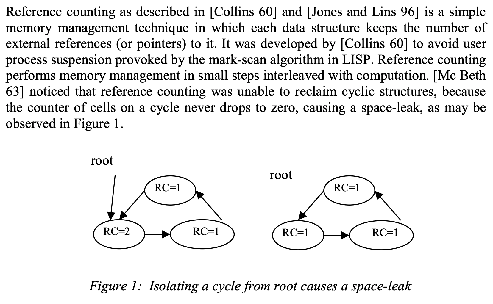

Languages like Python and Swift use reference counting extensively, and add affordances like Python's cycle collector, and in Swift's case, weak references and valgrind style tooling to detect leaks.


## Proposal

This proposal consists of these parts each of which has its own header below:

1. **`forbids` clause syntax**: extra syntax on type declarations including  `class`es, `interface`s, and type formal declarations.
1. **`class` cycle checks**: compile-time static checks for each `class` definition, the **class cycle checker**.
1. **`forbids` constraint checker**: compile-time checks on type bindings that they obey `forbids` clauses.
1. **A cycle test suite**: Including the examples below, a suite of test programs that fail and the error messages that should be produced along with similar programs that pass.
1. **Visualizations**: additions to the command line tool and in the REPL that aid in visualizing and repairing memory cycles by showing DOT graphs of how a memory cycle can be formed allowing quick identification of property chains and mutability that could change.
1. **Documentation**: documentation covering the rules in detail, motivation for target languages that don't have scanning GC, examples of what works and doesn't and how to change the ones that don't, and a coverage of topics like ownership, graph representation using façades.

## Rationale

Many programming languages have automatic garbage collection (GC). But that automatic garbage collection doesn't always deal well with cyclic data structures.  For example, C and C++ requires developers to pick one of a number of strategies to ensure deallocation: carefully pairing malloc and free instructions, associating allocations with block scopes during which the allocation is live, using a smart pointer type like a ref-counting pointer, allocating into an arena, etc. Python does use reference counting, but it has a secondary cycle collector that makes its memory management cycle-safe, but Python also relies on RAII-like patterns (resources held by a coroutine are freed on coroutine instance deallocation) that can be confused and delayed by reference cycles.

Simple reference counting semantics for Temper references is a sweet spot for high translatability. Without observable deallocation (no destructors with visible side-effects), target languages that assume scanning GC just work, and target languages that allow for reference counting can also be translated to.

And there is a style of programming, OCaml mostly immutable records, that is naturally acyclic.  Encouraging this style in Temper should mean that most code doesn't need to worry about memory management.  Those work because there is a natural ordering which allows proving absence of cycles: immutable members of an immutable record are older than the record.

This approach focuses the added burden on mutable and generic types.  The more concrete the types, the more information the checker has to reason about them; types that layer well (this obviously contains that but not vice versa) just work.

There are also a variety of fallback strategies if this proves hard to use:

- Scoped building idioms. Some mutable types like *ListBuilder* are mutable but short lived, so idioms like Kotlin `buildList { ... }` where the auto-allocated *ListBuilder* switches to a state where it is guaranteed always empty after control exits the `}`, can be exceptions to the rule.  The output *List* type needs to pass the `forbids` constraint checker.
- Libraries for some apparently cyclic use cases like graphs based on adjacency tables.
- Weak references and ephemerons can allow for parent pointers in AST representations without breaking use cases where the root pointer is strong and not held by an AST.
  But a weak reference value clears when its target is collected, at once under reference counting and at some unpredictable time under a scanning collector.  Observable deallocation exposes semantic differences and non-determinism, so a design like JavaScript's intentionally non-enumerable weakly-keyed *WeakMap* might be preferable.

## Compatibility

This change will probably break existing code that uses `interface`s in ways that would allow a new implementation of the `interface` to refer back to a thing that holds the interface.

For an effectively `@imu` type, often specifying that the interface is `@imu` may allow working around this, but in other cases, extra `forbids` relationships may allow working around problems.

## Implementation

https://github.com/temperlang/acyclic-types is an experimental
implementation of the type definition cycle checker.

### Drop-order graphs

*acyclic-types* defines a kind of graph that herein we call a
*drop-order graph* (examples below) that is constructed to check
`class` and `interface` type declaration.  It always starts with the
type being checked, and for each backed property (properties that
correspond to memory containing a pointer to a things) we have an edge
to a node for that properties type.  And those nodes can have outgoing
nodes based on their type (rules below explain those for *Never*,
*Result*, nullable, and other builtin kinds of types).  There can be
multiple nodes in play for the same type definition; for example, a
`List<List<X>>` can point to a `List<X>` which can point to an `X`.
Abstract types are exploded out based on worst-case assumptions; type
parameter references based on analysis of their upper-bounds pruned by
forbids clauses (assuming *AnyValue* if there are no constraining
upper bounds), and interfaces based on possible subclasses.

The goal of a *drop-order graph* is to make it easy to identify the
potential for object-graph cycles.  There are multiple kinds of edges.
A can-be-a edge (`is?`) expresses that the origin type is assignable to
the destination type.  A `<=` points-to edge expresses that the origin can
point-to the destination via a property that is assigned once and in the
constructor before `this` is used as an rvalue. A simple `<` points-to
edge denotes any other points-to relationship.

If a cycle in the drop-order graph has no `<` edges, then there is
no contradiction: the born-after property holds among early-initialized
const property chains, so there's no problem.  If there is a cycle
involving `<` edges, then there is a problem: there is no guarantee
that there is a valid order in which values are dropped (deallocated);
for some value to be dropped, it would have to have been dropped before
it can be dropped.  That intuition meshes with the idea that a ref-count
cycle is a problem because you'd have to decrement the ref-count to zero
before it can reach zero via the rules of ref-counting.

### Outgoing drop-graph edges

A nullable type (postfix `?` type) node has a single outgoing edge to
the node for its non-nullable as a `<=` edge.  `Foo? -> Foo`.  A
`Foo?` property can point to a `Foo` or to the special `null` value
but we don't bother representing that `null` value with a node because
it points to nothing.

There is no value of a `Never` type that points to anything, so when building a
drop-order graph, a drop-order graph node for a type like `Never<Foo>` has no
outbound edges.  It's fine if a backed property with type `Never<Foo>?` just
points to a `Never<Foo>` node but it's also fine to optimize those out since
both non-nullable Never nodes and nulls are dead-ends.

`Result<Foo, Bar>` can point to a `Foo` or a `Bar` but as these are only valid
as return types, and not as property types, they should not show up in drop-order
graphs for types that do not have other serious problems.  Their outgoing edges
are `<=` edges.

A functional interface type may have `forbids` clauses that constrain what it
can close over, so functional interface types are just like other interface types.
They do not necessarily point to anything related to their input or return types.

We assume non-empty lists are possible (except for `List<Never<...>>`)
so a `List<Foo>` can point to a `Foo` via the `.0` (element 0) pseudo property.
Lists can have more than one element, but there's no need for repetitive edges;
an analysis optimistically assuming all lists are of length 1 is sufficient.
`List`s references to their elements are `<=` edges.

Likewise `Listed<Foo>` and `ListBuilder<Foo>` have an element 0 pseudo property
but it is non-const, a `<` edge.

`Mapped` and its subtypes have two outgoing edges to the key type and the value
type.  For `Map` the edges are `<=` edges.  For `Mapped` and `MapBuilder` they are
`<` edges.  Using the pseudo property names `.key` and `.val` should make drop-edge
graphs readable.

`String`, `StringBuilder`, the numeric types, booleans, string index types,
and the empty type need no outgoing edges.
They may internally have storage for bits, and the stringy types might have
backing arrays, but any content bottoms out on non-pointer bits so is ignorable
for the purposes of cycle checking.

For a type parameter reference, e.g. a `T` type corresponding to a `<T>` declaration,
there are two cases: `<T>` is declared `@imu` (deeply immutable) or it is not declared
`@imu`.  If it does not have `@imu` type metadata then it needs `can-be-a` edges to each
type node that exists and which fits its upper bounds.
If it is declared `@imu` then it needs outgoing `can-be-a` edges in the same way but only
to those nodes which are effectively-imu.

Similarly, sealed interface type nodes have outgoing edges to the nodes for their
direct subtypes, filtered by `@imu`.

Non-sealed interface types (including `@fun` interfaces) have outgoing edges to
fictional class types (see `*Sub` types in examples below) that have a property
`x` that points back to the subject type: the class being checked.  That property
might be pruned as below, but it's entered into the graph.  If the interface type
has `@imu` metadata then the synthesized property is a `<=` edge, but it is a `<`
edge otherwise.

A non-sealed interface node needs no edges to the classes already in the graph that
implement it.  Only cycles through the subject are reported, so the fictional class,
which points straight back to the subject by the worst kind of edge allowed, covers
every path that a real implementation could add.

Both type parameter reference nodes and interface type nodes are
subject to edge pruning based on `forbids` clauses.  (See examples of
edge pruning below under test and examples.)

### Forbids

The `forbids` operator is already in the operator table.  `forbids`
should be allowed in `interface` and `class` definitions as well as
type formal definitions, so the data structures that track type
definitions generically should store a list of forbidden types.

`forbids` has the same precedence as `extends` and, like it allows multiple
right operands via `&`, so they can combine:
`<T extends Event forbids Registry & Listener>`.

What a `forbids` clause promises depends on where it is.

On a `class` or `interface`, `X forbids Y` promises that no value of type
`X` points to a `Y` through any chain of properties.  It says nothing
about whether the value is itself a `Y`, so a type can forbid itself:
`class Node forbids Node` says that a `Node` never points to a `Node`,
directly or indirectly.

On a type formal, `<T forbids Y>` promises that `T` neither binds to nor
points to a `Y`: no value of `T` is a `Y` or points to one.  So `T` can't
be bound to `Y`, to a subtype of it, or to a type like *AnyValue* whose
values might be one.

The two agree: a type formal's values are what something else, the thing
whose property has type `T`, points to, and a value that something
forbidding `Y` points to, directly or not, can't be a `Y` either.
Forbidding `Y` also forbids `Y`'s subtypes.  Subtypes of an interface
inherit its `forbids` clauses, and a type that a type formal binds to must
keep the type formal's.

Core types whose element edges are `<` edges need clauses on their type
formals, or nothing stops a builder from holding itself, as in the
`ListBuilder<AnyValue>` example under *New reference topic: `forbids`
clauses*:

```ts
class ListBuilder<T forbids ListBuilder<T>> ...
class MapBuilder<K extends MapKey<K>, V forbids MapBuilder<K, V>> ...
class Deque<T forbids Deque<T>> ...
```

These are checked like any other bound, at each type phrase:
`ListBuilder<AnyValue>` fails, since an *AnyValue* could be a
`ListBuilder<AnyValue>`, while `ListBuilder<String>` and
`ListBuilder<List<Foo>>` pass.  They also imply that a `ListBuilder<T>`
doesn't point to a `ListBuilder<T>`, so `class ListBuilder<T forbids
ListBuilder<T>> forbids ListBuilder<T>` would check too.  `Cons` below
uses the same kind of clause, `<T forbids Cons<T>>`, though it couldn't
forbid itself at the class level, since its `tail` points to another,
older `Cons`.

`Listed` and `Mapped` are implemented only by core types, so they can be
treated as sealed over their immutable and builder variants.

### Visualization and debugging aid

The REPL visualizations would benefit from a dependency on a command
line image display library like
[imgcatr](https://github.com/SilinMeng0510/imgcatr).  Generating a
Graphviz (`.dot`) or Mermaid file (perhaps am out-grammar could help),
invoking the shell to convert to an image and then displaying the
resulting image could help with showing drop-order graphs in error
messages and in the REPL.  (The web playground already supports
Mermaid rendering using Mermaid JS library support) A MessageTemplate
that identifies an output as inlinable image output could allow
optional inlining if in interactive mode and the user has not
expressed a preference for accessible textual content.

Diagrams should show only the edges that explain the problem.  The graph
marks edges that only Step V uses (`DropOrderEdge.onlyForForbids`), so a
diagram of a cycle can leave them out.

### Cycle Checking algorithm

Cycle checking is done per `class` declaration because other type
declarations do not allocate storage.  Forbids checking is done per
type phrase; every type that appears in a node's AST.  The former
need not be cached because each `class` is only considered once; the latter
can be aggressively cached as long as care is taken not to use cached
state from before a type declaration is modified by metaprogramming.

```temper
// Pseudocode
sealed interface EdgeKind {
  /** The type the edge points to. */
  type: Type2;

  @operator("==")
  eq(that: EdgeKind): Boolean;

  toString(): String;
}

class HasAEdgeKind(
  /** The type the edge points to. */
  public type: Type2,
  /**
   * True iff the property is non-var and initialized before
   * the `this` of its container is used as an rvalue.
   */
  public early: Boolean,
  /** Non-normative.  Lets us reconstruct property chains. */
  public propertyHint: String,
) extends EdgeKind {
  @operator("==")
  public eq(that: EdgeKind): Boolean {
    that is HasAEdgeKind && this.type == that.type && this.early == that.early
  }

  public toString(): String {
    "${if (early) { "<=" } else { "<" }} ${propertyHint} : ${type}"
  }
}

class CanBeAEdgeKind(
  /** The type the edge points to. */
  public type: Type2,
  /**
   * Non-normative.  For Step II's edges from another instantiation of
   * mainType's class to mainNode, the binding of mainType's type formals
   * under which they're the same type, like `T = String`.
   */
  public bindingHint: String? = null,
) extends EdgeKind {
  @operator("==")
  public eq(that: EdgeKind): Boolean {
    that is CanBeAEdgeKind && this.type == that.type
  }

  public toString(): String {
    if (bindingHint == null) { "is? ${type}" } else { "is? ${type} (${bindingHint})" }
  }
}

@auto("==")
class DropOrderKey(
  public type: Type2,
  /**
   * Type parameters like `<@imu T>` can specify they bind to an intersection of types but
   * only effectively-imu variants of that intersection.
   *
   * Propagate that is-imu bit so that we can use `<=` outgoing edges from them.
   * This ends up affecting the has-a edges synthesized for worst-case interfaces.
   */
  public imuOverride: Boolean,
) forbids DropOrderGraph {}

class DropOrderNode(
  /**
   * Auto-assigned when added to the graph.
   * Serially assigned starting at 0 so suitable for arrays that associate by index.
   */
  public serialNo: Int32,
  public key: DropOrderKey,
) forbids DropOrderGraph {}

class DropOrderEdge(
  public origin: DropOrderKey,
  public destination: DropOrderKey,
  public kind: EdgeKind,
  /**
   * True for the edges Step V adds from fake classes to the types mainType
   * forbids.  Steps III and IV never see them, and a diagram of a cycle
   * should leave them out.
   */
  public onlyForForbids: Boolean = false,
) forbids DropOrderGraph {
  /**
   * Set by Step III when another type's `forbids` clause rules the edge out.
   * Steps IV and V skip these.
   */
  public var pruned: Boolean = false;
}

class DropOrderGraph {
  // Internal state elided.

  /** Gets the node for key, adding one if there is none. */
  public nodeForKey(key: DropOrderKey): DropOrderNode;

  public addEdge(
    origin: DropOrderNode, kind: EdgeKind, dest: DropOrderNode,
    onlyForForbids: Boolean = false,
  ): Void;

  /** In serialNo order. */
  public allNodes(): List<DropOrderNode>;

  public outgoing(key: DropOrderKey): List<DropOrderEdge>;

  public incoming(key: DropOrderKey): List<DropOrderEdge>;
}

/**
 * A cycle through the main node: the edges in order, starting and ending
 * at the main node, including at least one non-early has-a edge.
 */
class Cycle(
  public edges: List<DropOrderEdge>,
) {}

class ForbidMismatch(
  public forbidden: Type2,
  public transitivelyHas: Type2,
  /** The shortest chain of property hints via which transitivelyHas is reachable. */
  public viaPath: List<String>,
  /**
   * True if `forbidden` is forbidden along some paths to `transitivelyHas` but not
   * all, which suggests where a `forbids` clause would close the gap.
   */
  public forbiddenOnSomePaths: Boolean,
  /**
   * If some bindings of mainType's type formals would rule the mismatch out,
   * a `forbids` clause on a type formal that would, for the message to
   * suggest, like `T forbids String` for `class C<T> forbids List<T>` with a
   * `List<String>` property.
   */
  public suggestedBound: TypeFormalBound?,
) {}

class CycleCheckProblems(
  public graph: DropOrderGraph,
  public cycles: List<Cycle>,
  public forbidMismatches: List<ForbidMismatch>,
) {}

let checkClassTypeForPotentialReferenceCycles(classTypeShape): CycleCheckProblems {
  let graph = new DropOrderGraph();

  // The type of `this` in one of the `class`'s methods.
  // If `classTypeShape` is `C` and has type formals `<T, U>`
  // then mainType is `C<T, U>`.
  let mainType = MkType2(classTypeShape)
      .bindings(classTypeShape.typeFormals.map { t => MkType2(t).get() })
      .get();
  let mainTypeKey = new DropOrderKey(mainType, false);

  // We need to navigate from there to check for cycles once
  // we've added edges and pruned them.
  let mainNode = graph.nodeForKey(mainTypeKey);

  // Build out the graph.
  //
  // First, we build out all has-a edges.
  //
  // Second, we'll link can-be-a edges and potentially add nodes for
  // super-types, but those nodes rarely add new has-a relationships because
  // previously unseen super-types are usually non-class types which have
  // no properties.
  // There are two exceptions to the rule:
  // 1. When an `interface` type is `sealed`, and some of its
  //    direct sub-types are `class` types.  We add can-be-a edges to
  //    the direct sub-types and note that they may have properties.
  // 2. When a <T> can-be-a <U> and the <U> has a class type as an upper-bound,
  //    the outer loop repeats.  This is a rare case as class types are not
  //    often useful upper bounds.
  //
  // Third, and only after we've converged on all the edges do we prune edges
  // using `forbids` relationships.
  //
  // Fourth, we build a list of cycles by navigating from the mainNode.
  // We do not look for cycles from other nodes, even if they are class nodes.
  // They will get checked when it's their turn.  Cycles among core types, like
  // a ListBuilder that holds itself, are ruled out by core types' `forbids`
  // clauses, which the forbids constraint checker checks at each type phrase.
  //
  // Fifth, we check that the class definition respects its own (including inherited)
  // `forbids` clauses.  We scan super-types and contextualize super-type `forbids`
  // clauses, and collect them.  Then we check that each backed property's type does
  // not point to anything forbidden either by having a sufficient forbids type or
  // by being a class type that does not in fact point to anything forbidden, or
  // being a sealed interface type each of whose direct sub-types falls into one of
  // the above categories.

  let needsHasAEdges = new Deque<DropOrderKey>();
  needsHasAEdges.add(mainTypeKey);
  let hasAEdgesDone = new SetBuilder<DropOrderKey>();
  // These outlive one pass of the outer loop: a key explodes at most once,
  // and Step III needs every fake node.
  let exploded = new SetBuilder<DropOrderKey>();
  let fakes = new SetBuilder<DropOrderNode>();
  while (!needsHasAEdges.isEmpty) {
    // Step I
    while (true) {
      let key = needsHasAEdges.popOrNull();
      if (key == null) {
        break
      } else {
        if (hasAEdgesDone.has(key)) {
          continue;
        }
        hasAEdgesDone.add(key);

        // backedPropertiesOf also lists the pseudo-properties per the
        // rules below that indicate that `Never` types have no properties
        // and lists `List` types as having a `.0` pseudo property.
        for (let p of backedPropertiesOf(key.type)) {
          // For a `class Foo<T>(public myProp: List<T>)`
          // the type of .myProp in context of `Foo<String>` is `List<String>`.
          //
          // Our analysis is the same even if all nullable property types and
          // TypeFormal upper bounds are replaced with the corresponding non-nullable
          // type, so we just avoid bloating graphs and sets
          // (and the visual representation of drop-order graphs) with nodes
          // for nullable types by using `nonNullableOf`.  It just returns the
          // non postfix-`?` type for one that has it, or the type given otherwise.
          //
          // Polymorphic recursion, as in `class N<T>(public n: N<List<T>>?)`,
          // would reach N<List<T>>, N<List<List<T>>>, ... without end.
          // widenDeepTypeArguments replaces each type argument nested deeper
          // than a fixed limit with the worst case for the type formal it
          // binds: its upper bounds (AnyValue if none), keeping the formal's
          // `@imu` and `forbids`.  That only adds possible values, so it's
          // conservative, and there are finitely many keys.
          let pTypeInContext = widenDeepTypeArguments(
            nonNullableOf(propertyTypeInContext(p, key.type))
          );
          let pIsEarly = key.imuOverride || isEarly(p);
          let pTypeKey = new DropOrderKey(pTypeInContext, key.imuOverride);
          if (!hasAEdgesDone.has(pTypeKey)) {
            needsHasAEdges.add(pTypeKey);
          }
          let pNode = graph.nodeForKey(pTypeKey);
          let pHint = propertyHintFor(p);
          let kNode = graph.nodeForKey(key);
          graph.addEdge(kNode, new HasAEdgeKind(pTypeInContext, pIsEarly, pHint), pNode);
        }
      }
    }

    // Step II. Add can-be-a edges.
    let needExplodeSupers = new Deque<DropOrderKey>();
    for (let node of graph.allNodes()) {
      needExplodeSupers.add(node.key);
    }
    while (true) {
      let key = needExplodeSupers.popOrNull();
      if (key == null) {
        break;
      } else {
        let type = key.type;
        if (exploded.has(key)) { continue; }
        exploded.add(key);
        // Another instantiation of mainType's class, like `C<String>` in
        // `C<T>`'s graph, is mainType when `T` is `String`.  A run-time cycle
        // through a `C<String>` maps into this graph with `T` bound to
        // `String`, starting at mainNode, but can come back to the
        // `C<String>` node instead, as for `class C<T>(public var c:
        // C<String>?)`.  This edge leads it on to mainNode, so Step IV finds
        // it.  No other class's check would: only `C`'s graph has `C<T>`.
        //
        // couldBeInstantiationOf(type, mainType) is true if type is mainType's
        // class applied to arguments that mainType's type formals could be
        // bound to: ones that meet their bounds, as far as can be told, and
        // in particular aren't subtypes of anything they forbid.
        if (key != mainTypeKey && couldBeInstantiationOf(type, mainType)) {
          graph.addEdge(
            graph.nodeForKey(key),
            new CanBeAEdgeKind(mainType, bindingOf(type, mainType)),
            mainNode,
          );
        }
        if (isClassType(type)) { continue; }
        if (isInterfaceType(type)) {
          if (isSealedInterfaceType(type)) {
            // Add can-be-a relationships.
            // We're just listing out the direct subtypes, not their subtypes transitively.
            // If type is `I<List<String>>` and I is based on `sealed interface I<T>` and
            // `class C<U> extends I<List<U>>` then we use our backwards projection to
            // come up with `C<String>`
            for (let subType of directContextualizedSubTypesOf(type)) {
              let subKey = new DropOrderKey(subType, key.imuOverride);
              if (isClassType(subType)) {
                if (!hasAEdgesDone.has(subKey)) {
                  // First re-enter outer loop condition described above.
                  needsHasAEdges.add(subKey);
                }
              } else {
                needExplodeSupers.add(subKey);
              }
              let kNode = graph.nodeForKey(key);
              let subNode = graph.nodeForKey(subKey);
              graph.addEdge(kNode, new CanBeAEdgeKind(subType), subNode);
            }
          } else {
            // Construct a worst-case class type specifically
            // for mainType that extends type.
            // This is one of the reasons that we don't try to cache
            // drop-graphs for one type that happen to explode out things for
            // other class-types.

            let fakeClassType = constructFakeClassType(
              type, // that it extends.  Also type's definitions's name is used as a hint.
              mainType, // type for its property,
              key.imuOverride,
            );
            let fakeKey = new DropOrderKey(fakeClassType, key.imuOverride);

            let kNode = graph.nodeForKey(key);
            let fakeNode = graph.nodeForKey(fakeKey);
            fakes.add(fakeNode);
            graph.addEdge(kNode, new CanBeAEdgeKind(fakeClassType), fakeNode);
            let isEarly = key.imuOverride || isImu(type);
            let pHint = ".x";
            graph.addEdge(fakeNode, new HasAEdgeKind(mainType, isEarly, pHint), mainNode);
            hasAEdgesDone.add(fakeKey);
          }
        } else if (isTypeFormalReference(type)) {
          let upperBounds = type.upperBounds;
          let isImuRef = key.imuOverride || isImu(type);
          let boundKeys = if (upperBounds.isEmpty) {
            [new DropOrderKey(anyValueType, isImuRef)]
          } else {
            upperBounds.map { ub => new DropOrderKey(ub, isImuRef) }
          }
          // WARNING: fanning out like this is like unioning,
          // but the semantics of type formal upper bounds
          // are intersection.
          // TO DISCUSS: Should nodes store intersections of types instead of one-type?
          // If so, then `forbids` clauses would be unioned over the types' clauses.
          for (let boundKey of boundKeys) {
            let kNode = graph.nodeForKey(key);
            if (!hasAEdgesDone.has(boundKey)) {
              needsHasAEdges.add(boundKey);
            }
            // A bound is usually an interface, like AnyValue, so it needs
            // exploding in this pass, not only once the outer loop repeats.
            needExplodeSupers.add(boundKey);
            let boundNode = graph.nodeForKey(boundKey);
            graph.addEdge(kNode, new CanBeAEdgeKind(boundKey.type), boundNode);
          }
        }
      }
    }
  }

  // Step III. Propagate `forbids` relationships, then prune out fake classes'
  // has-a edges based on them.
  //
  // `X forbids Y` promises that no X transitively points to a Y.  A node's
  // values don't point to a Y if its type forbids Y, or if every node with an
  // edge to it is like that: a value that points to a Y would be pointed to
  // by values that do too, and over a can-be-a edge it's the same value.
  // Then Y is "always forbidden" there.  If it's forbidden on some paths but
  // not all, it's "sometimes forbidden", which only matters for advice in
  // messages.
  //
  // Two kinds of forbidden type matter:
  // - mainType, here, to prune fake classes' edges back to mainNode;
  // - the types that mainType's own and inherited `forbids` clauses name, in
  //   Step V, after it adds more edges.
  //
  // mainType's own clauses don't count as reasons in the propagation, since
  // Step V is what checks them; using them there would assume what's being
  // proven.  So mainNode itself is never "always forbidden".  Every other
  // node's clauses are checked elsewhere: a class's in its own Step V, an
  // interface's in each implementation's Step V, and a type formal's
  // wherever it's bound.

  @auto("==")
  class ForbidsFreq(
    public forbids: Type2,
    /** Bits by serialNo, for nodes where `forbids` is always forbidden. */
    public always: DenseBitVector,
    /** Bits by serialNo, for nodes where it's forbidden along at least one path. */
    public sometimes: DenseBitVector,
  ) {}

  // Computes "always" and "sometimes" for one forbidden type, on the graph
  // as it is when called.
  let forbidsFreq(forbidden: Type2): ForbidsFreq {
    // Nodes reachable from mainNode by at least one edge, so mainNode is
    // included only if a cycle leads back to it.
    let reachable: DenseBitVector = reachableFrom(graph, mainNode);
    let always = new DenseBitVector();
    let sometimes = new DenseBitVector();

    // A node forbids `forbidden` itself if its type (or, for a fake class,
    // the interface it extends) has a `forbids` clause naming a super-type
    // of `forbidden`.  mainNode's own clauses don't count.
    let declares(node: DropOrderNode): Boolean {
      node != mainNode && declaresForbidding(node.key.type, forbidden)
    }

    // "always" is a greatest fixed point: start by assuming every reachable
    // node but mainNode is always forbidden, then knock out each node that
    // doesn't declare it and has an incoming edge from a node that isn't.
    // A node is knocked out at most once, so this is linear in the edges.
    for (let node of graph.allNodes()) {
      if (node != mainNode && reachable[node.serialNo]) {
        always[node.serialNo] = true;
      }
    }
    let recheck = new Deque<DropOrderNode>();
    recheck.add(mainNode);
    while (true) {
      let from = recheck.popOrNull();
      if (from == null) { break; }
      // `from` is not always forbidden, so its followers might not be either.
      for (let edge of graph.outgoing(from.key)) {
        let to = graph.nodeForKey(edge.destination);
        if (always[to.serialNo] && !declares(to)) {
          always[to.serialNo] = false;
          recheck.add(to);
        }
      }
    }

    // "sometimes" is a least fixed point: a node is sometimes forbidden if it
    // declares it, or any node with an edge to it is sometimes forbidden.
    let spread = new Deque<DropOrderNode>();
    for (let node of graph.allNodes()) {
      if (reachable[node.serialNo] && declares(node)) {
        sometimes[node.serialNo] = true;
        spread.add(node);
      }
    }
    while (true) {
      let from = spread.popOrNull();
      if (from == null) { break; }
      for (let edge of graph.outgoing(from.key)) {
        let to = graph.nodeForKey(edge.destination);
        if (!sometimes[to.serialNo]) {
          sometimes[to.serialNo] = true;
          spread.add(to);
        }
      }
    }

    new ForbidsFreq(forbidden, always, sometimes)
  }

  // Each fake node's only has-a edge goes back to mainNode.  Where mainType is
  // always forbidden, no real implementation could point back, so prune it.
  let mainForbids = forbidsFreq(mainType);
  for (let fake of fakes) {
    if (mainForbids.always[fake.serialNo]) {
      for (let edge of graph.outgoing(fake.key)) {
        edge.pruned = true;
      }
    }
  }

  // Step IV. Find cycles through mainNode that include at least one `<` edge.
  //
  // For each non-early has-a edge u -> v, where u is reachable from mainNode
  // and mainNode is reachable from v, both via unpruned edges, there's a
  // cycle: a shortest path from mainNode to u, the edge, and a shortest path
  // from v back to mainNode.  Reporting one cycle per such edge gives one
  // diagnosis per property whose mutability matters, and each `<` edge is a
  // place where the user could break the cycle.  Can-be-a edges are walked
  // like any other, but aren't pointers, so they are never the `<` edge.
  // That includes Step II's edges from other instantiations of mainType's
  // class, so a cycle back to one of those comes back to mainNode too.
  //
  // shortestPaths does a breadth-first search over unpruned edges, forwards
  // from mainNode or backwards to it.  Like
  // reachableFrom, its `reaches(n)` means by a path of at least one edge, so
  // it's true of mainNode only when a cycle leads back to it.
  let fromMain = shortestPaths(graph, mainNode, Direction.forwards);
  let toMain = shortestPaths(graph, mainNode, Direction.backwards);
  let cycles = new ListBuilder<Cycle>();
  for (let u of graph.allNodes()) {
    if (fromMain.reaches(u) || u == mainNode) {
      for (let edge of graph.outgoing(u.key)) {
        let kind = edge.kind;
        if (
          !edge.pruned && kind is HasAEdgeKind && !kind.early
        ) {
          let v = graph.nodeForKey(edge.destination);
          if (toMain.reaches(v) || v == mainNode) {
            cycles.add(new Cycle([...fromMain.pathTo(u), edge, ...toMain.pathFrom(v)]));
          }
        }
      }
    }
  }

  // Step V. If mainType has `forbids` clauses, own or inherited, and Step IV
  // found no cycles, check that mainType keeps them.
  //
  // `forbids` is about pointing to, so it's checked at has-a edges: mainType
  // breaks a promise if some has-a edge u -> v, on a path from mainNode, can
  // point to a value of the forbidden type.  It can if v's values could be
  // one: v's type is a subtype of the forbidden type, or is abstract (an
  // interface or a type formal) and could be bound to or implemented by one.
  // mayBeA checks both, and knows that a type formal can't be bound to a
  // type its own `forbids` clauses name.  It can't if u's values don't point
  // to one (Step III's "always").  mainNode's values may themselves be the
  // forbidden type; only what they point to matters.
  //
  // Checking only the has-a edges is enough: a value reached over can-be-a
  // edges is the value at the end of the last has-a edge, whose type is a
  // super-type of the value's, so mayBeA is already true there.
  //
  // A fake class stands for any implementation of its interface, which might
  // point to a forbidden type through objects the graph doesn't show.  Its
  // `.x` edge stands for every path back to mainNode; here it gets a has-a
  // edge to each forbidden type, standing for every path there.  If the
  // interface forbids that type, or every path to the fake passes something
  // that does, it's "always" forbidden at the fake, and the edge is fine.
  // Otherwise it's a mismatch, and the message can suggest adding the clause
  // to the interface.  The edges needn't lead anywhere else: reaching a
  // forbidden type is already a mismatch, and each forbidden type gets its
  // own edge.  Other types' clauses need no edges, since each implementation
  // checks its own.  So a class with a property that can hold an *AnyValue*
  // can't forbid anything, which is as it should be: *AnyValue* suits bounds
  // on type formals better than data.
  //
  // These edges are added only after Step IV, which would take a path through
  // one of them back to mainNode for a cycle, even with the fake's `.x` edge
  // pruned.  No implementation that keeps the interface's clauses could make
  // that cycle, and if `.x` isn't pruned, Step IV has reported it already.
  // They're marked onlyForForbids, so that diagrams of cycles can leave them
  // out.
  //
  // Every mismatch is an error at the class declaration.  Clauses that
  // depend on type formals are checked here, not at type phrases: if v's
  // type and the forbidden type overlap only for some bindings, as
  // `List<String>` and `List<T>` do, the fix is a bound on the type formal
  // that rules those bindings out, and the message suggests one (see
  // ForbidMismatch.suggestedBound).  With that bound, mayBeA is false, and
  // type phrases only need the usual check that type arguments meet bounds
  // (see *Forbids constraint checker*).
  //
  // A class that forbids itself needs no special handling.  Step III doesn't
  // use mainType's own clauses, so fake classes' edges back to mainNode stay
  // unless other clauses prune them, and Step IV reports any cycle through
  // them.  For `class ListBuilder<T forbids ListBuilder<T>> forbids
  // ListBuilder<T>`, `T`'s clause prunes them, and Step V finds `.0`'s
  // target, `T`, can't be a `ListBuilder<T>` and points to none.
  let ownForbids: List<Type2> = contextualizedForbidsOf(mainType); // own and inherited
  let mismatches = new ListBuilder<ForbidMismatch>();
  if (!ownForbids.isEmpty && cycles.isEmpty) {
    for (let fake of fakes) {
      for (let forbidden of ownForbids) {
        let forbiddenNode = graph.nodeForKey(new DropOrderKey(forbidden, false));
        graph.addEdge(
          fake, new HasAEdgeKind(forbidden, false, ".x"), forbiddenNode,
          /* onlyForForbids= */ true,
        );
      }
    }
    let fromMainForV = shortestPaths(graph, mainNode, Direction.forwards);
    for (let forbidden of ownForbids) {
      let freq = forbidsFreq(forbidden);
      for (let u of graph.allNodes()) {
        if (
          (u == mainNode || fromMainForV.reaches(u)) && !freq.always[u.serialNo]
        ) {
          for (let edge of graph.outgoing(u.key)) {
            let v = graph.nodeForKey(edge.destination);
            if (
              !edge.pruned && edge.kind is HasAEdgeKind &&
              mayBeA(v.key.type, freq.forbids)
            ) {
              let suggestedBound =
                boundRulingOutOverlap(v.key.type, freq.forbids, mainType);
              mismatches.add(
                new ForbidMismatch(
                  freq.forbids,
                  v.key.type,
                  [...fromMainForV.pathTo(u), edge].map { e => propertyHintOf(e) },
                  freq.sometimes[u.serialNo],
                  suggestedBound,
                )
              );
            }
          }
        }
      }
    }
  }

  new CycleCheckProblems(graph, cycles.toList(), mismatches.toList())
}
```

Pruning is safe because a fake node stands for any class, in any
library, that implements a non-sealed interface.  Each such class
inherits the interface's `forbids` clauses, and its own Step V checks
them.  Type formals' clauses are checked wherever they're bound.  So a
prune never relies on a promise that this same check is responsible for.

We only look at cycles through the main node.  Any other cycle in the graph either passes
through another class, which is reported when that class is checked, or
runs only through core types and interfaces, which core types' `forbids`
clauses rule out.

This is sufficient.  Suppose every class passes, every type phrase
passes the forbids constraint checker, and no constructor uses `this`
as an rvalue before setting its early properties.  If a reference cycle
still formed at run time, pick an object on it, of type *C<A>*.  Each
pointer on the cycle maps to a path in *C*'s graph, with *C*'s type
formals bound to *A*: a has-a edge to the property's type, then can-be-a
edges to the actual class, or to a fake class standing in for it.  The
path may come back to another node that is *C<A>* under that binding,
like `C<String>` for `C<T>`, but Step II's can-be-a edge from there leads
on to *C*'s node.  So the run-time cycle is a cycle through *C*'s node,
and since *C* passed, it has a `<` edge.  Then the birth order
principle must hold: each object on the cycle would be older than the
one pointing to it, and so older than itself.

The soundness relies on these pieces working correctly:

- the constructor rule is sound w.r.t. early properties
- closures need to be checked as the ad-hoc classes described under *Implicit cycles via
  closure conversion*
- and code the checker can't see (`@connected` classes, and target language implementations of Temper interfaces) needs to obey `forbids` clauses of the types it implements.

That last requirement is unlikely to hold in practice, but the best the Temper language
can do is prevent object graphs constructed entirely in Temper from leaking memory.  It
cannot prevent target language code from leaking memory with or without code translated
from Temper in the mix.  By documenting `forbids` clauses, we hope that we can make clear
expectations when using Temper libraries, following the principle of least surprise, and
then developers can use the target language's toolchain to find the cause of leaks in
the hand-written target language code.

### Forbids constraint checker

The cycle checker trusts type formals' `forbids` clauses: a type formal's
node counts as forbidding what its clauses name, and `mayBeA` knows that a
type formal can't be bound to a type it forbids.  The forbids constraint
checker is what makes that true.  It takes the unique type phrases in a
module, each with the type formals in scope where it appears, and checks
that each type argument meets its type formal's `forbids` clauses.

A type phrase without type arguments needs nothing here.  A class's own
clauses are checked by its cycle check, and an interface's by each
implementation's.  Type formal references and *AnyValue* have nothing to
check either.  Nested type phrases are in the list too, so each phrase only
checks its own arguments.

For a type phrase `G<A1, ..., An>`, each type formal `Ti` of `G`, and each
type `Y` that `Ti` forbids, with `G`'s type formals bound to the
arguments, `Ai` must neither bind to nor point to `Y`:

1. `Ai` isn't a subtype of `Y`.
2. `mayBeA(Ai, Y)` is false: no value of `Ai` could be a `Y`.
3. No value of `Ai` points to a `Y`.

The first is needed even though the second usually implies it.  A type with
no values, like a sealed interface with no sub-types, passes the second,
but the cycle checker assumes the first.  When it asks whether a node like
`C<I>` could be mainType `C<T>`, for Step II's edges back to mainNode, or
matches types in `mayBeA`, it rules out bindings of `T` to subtypes of what
`T` forbids.

The third is the cycle checker's Step V, run on a graph rooted at `Ai`
rather than at a class.  The pieces need three parameters that
`checkClassTypeForPotentialReferenceCycles` fixes:

- **Building the graph** (Steps I and II) takes the root key, and mainType
  if there is one.  Without one, fake classes get no `.x` edge back: there's
  no main node to point back to.  Each fake class still gets Step V's edge
  to `Y`, standing for every path an implementation could take to one.
- **`forbidsFreq`** takes the graph, the start node, the forbidden type, and
  whether the start node's own clauses count.  For a class check they don't,
  since Step V is what checks them.  Here they do: if `Ai` is a class type,
  its own cycle check checks its clauses, and if it's an interface type,
  each implementation's does.
- **Step V's scan** takes the graph, the start node, and the `ForbidsFreq`,
  and returns the mismatches: has-a edges from the start node or nodes it
  reaches, where the source isn't "always" forbidding `Y` and the
  destination's type may be a `Y`.

Step III's pruning and Step IV aren't needed, since there's no cycle to look
for.

```temper
// Pseudocode
class ForbidsBoundViolation(
  /** The type phrase, like `C<String>`. */
  public phrase: Type2,
  /** The type formal whose clause the argument breaks, like `C`'s `<T>`. */
  public typeFormal: TypeFormal,
  /** The type argument, like `String`. */
  public argument: Type2,
  /** The forbidden type, with the phrase's type arguments substituted. */
  public forbidden: Type2,
  /** True if the argument is, or might be, a forbidden type. */
  public bindsTo: Boolean,
  /** If the argument might point to a forbidden type, how. */
  public pointsTo: List<ForbidMismatch>,
) {}

let checkTypePhrasesObeyForbids(
  // Each with the type formals in scope where it appears.
  phrases: List<Type2>,
): List<ForbidsBoundViolation> {
  let violations = new ListBuilder<ForbidsBoundViolation>();
  for (let phrase of phrases) {
    let typeFormals = typeFormalsOf(phrase.definition);
    for (let i = 0; i < typeFormals.length; ++i) {
      let typeFormal = typeFormals[i];
      let argument = phrase.bindings[i];
      for (let forbidsClause of typeFormal.forbids) {
        // For `ListBuilder<Foo>`, `ListBuilder<T>` becomes `ListBuilder<Foo>`.
        let forbidden = contextualize(forbidsClause, phrase);
        let bindsTo = isSubtype(argument, forbidden) || mayBeA(argument, forbidden);
        let pointsTo = if (bindsTo) { [] } else { pointsToForbidden(argument, forbidden) };
        if (bindsTo || !pointsTo.isEmpty) {
          violations.add(new ForbidsBoundViolation(
            phrase, typeFormal, argument, forbidden, bindsTo, pointsTo,
          ));
        }
      }
    }
  }
  violations.toList()
}

let pointsToForbidden(root: Type2, forbidden: Type2): List<ForbidMismatch> {
  let rootKey = new DropOrderKey(nonNullableOf(root), false);
  // Steps I and II, with no mainType.
  let (graph, fakes) = buildDropOrderGraph(rootKey, /* mainType= */ null);
  let rootNode = graph.nodeForKey(rootKey);
  // Step V's edges from fake classes.
  let forbiddenNode = graph.nodeForKey(new DropOrderKey(forbidden, false));
  for (let fake of fakes) {
    graph.addEdge(
      fake, new HasAEdgeKind(forbidden, false, ".x"), forbiddenNode,
      /* onlyForForbids= */ true,
    );
  }
  let freq = forbidsFreq(graph, rootNode, forbidden, /* startClausesCount= */ true);
  stepVMismatches(graph, rootNode, freq)
}
```

For the RFC's examples:

- `ListBuilder<AnyValue>` fails the second rule, since an *AnyValue* could
  be a `ListBuilder<AnyValue>`.
- `ListBuilder<List<Foo>>` passes if nothing in `List<Foo>`'s graph can
  point to a `ListBuilder<List<Foo>>`.
- `Box<fn (): Void>` fails the third rule unless `fn (): Void` forbids
  `Box`.  Its graph is the interface, a fake class for it, and the fake's
  edge to `Box<fn (): Void>`.  See *Open interfaces as type arguments*.
- In `let g<U>(c: C<U>)` with `class C<T forbids String>`, `U` fails the
  second rule.  In `let h<V forbids String>(c: C<V>)`, `V` passes all
  three: `mayBeA` knows `V` can't be a `String`.  `V`'s node, the root,
  declares `String`, so it's "always" forbidden there.

A result depends only on the phrase and on the clauses and bounds of the
type formals it mentions, so a phrase without type formal references can be
cached across modules, with the same care about metaprogramming as the
cycle checker's results.  Building a graph from a type argument can run into
polymorphic recursion, as Step I can, and widens the same way.

The cycle checker's sufficiency argument needs one more property from this
checker.  Run-time type arguments come from type phrases checked with type
formals in scope, as in `h` above, and are then bound by callers, so checking
must be stable under substitution.  If `C<V>` passes where `V` forbids
`String`, then `C<A>` must pass for each `A` that meets `V`'s bounds.

## Testing and examples

Kinds of tests:

Memory cycle checking is exclusively a frontend concern, so stage tests that capture error messages suffice for testing the static checks.

Testing image output in the REPL is important. Having a mode where visualizations output the text of the DOT visualization (or other), and so check the input content work.  A single end-to-end REPL or `temper build` test that uses a headless shell and screenshots might suffice to give confidence that visualizations make it through to the person behind the keyboard.  For non-sighted users, the DOT visualization should be sparse enough to read.

### Example: Cons list variants

A simple cons-list that does not allow for cycles.

```ts
class Cons<T forbids Cons<T>>(
  public head: T,
  public tail: Cons<T>?,
) {}
```

A forbidden type since it violates `forbids Cons<T>`

```ts
Cons<AnyValue>
```

Allowed types that obey `forbids Cons<T>`

```ts
Cons<String>
Cons<Cons<String>>
```


A variant of the cons-list that does allow for cycles as it misses the `forbids` clause.

```ts
class Cons<T>(
  public head: T,
  public tail: Cons<T>?,
) {}
```

If *X* is a constructed type like `class X(public var x: Cons<X>) {}` then this creates a cycle.

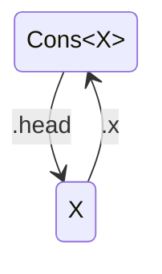

A variant of the cons-list that does allow for cycles as it allows for relinking tail.  There is no younger-than ordering principle.

```ts
class Cons<T forbids Cons<T>>(
  public head: T,
  public var tail: Cons<T>?,
) {}
```

Assuming there's some *X* that allows construction of a *Cons&lt;X&gt;*:

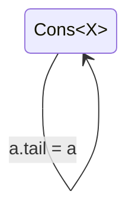

### Implicit cycles via closure conversion can be a problem.

```ts
let outer(wantEven: Boolean, i: Int32): fn (Int32): Boolean {
  // Two coreferential nested functions that close
  // over the same state.
  let isEven(j: Int32 = i): Boolean {
    j == 0 || isOdd(j - j.sign())
  }
  let isOdd(j: Int32 = i): Boolean {
    j != 0 && isEven(j - j.sign())
  }

  // Just a declaration that points to a function.
  // isEven and isOdd don't close over it, but if they
  // did, that'd be cyclic.
  var f = if (wantEven) { isEven } else { isOdd };

  f
}
```

Note that since `f` is returned here, `isEven` and `isOdd` do
not fall in the scoped function set proposed in
[RFC 693](../693-escaping-fns) for which we could ignore this
if we knew that backends could sever the function/record relationship
at the end of the scope.

JavaScript has a proper cycle-scanning garbage collector, but here's the
JS equivalent with [closure conversion] done to show which problems can
be avoided and which cannot.

Here's one way to do closure-conversion in JavaScript.

```ts
// Naive rewrite.
function outer(wantEven, i) {
  // Original functions renamed and with references to closed-over
  // state rewritten to point to an extra closureRecord input.
  function isEvenConverted(closureRecord, j = closureRecord.i) {
    return j === 0 || closureRecord.isOdd(j - Math.sign(j));
  }
  function isOddConverted(closureRecord, j = closureRecord.i) {
    return j !== 0 && closureRecord.isEven(j - Math.sign(j));
  }

  // Declare the original names, and a closure record.
  // Curry the converted functions with the shared record to
  // get function values that have the same signature and semantics
  // as the originals.
  const sharedClosureRecord =
    {
    };
  const isEven = isEvenConverted.bind(sharedClosureRecord);
  const isOdd = isOddConverted.bind(sharedClosureRecord);
  // Initialize the closure record.
  sharedClosureRecord.isEven = isEven;
  sharedClosureRecord.isOdd = isOdd;
  sharedClosureRecord.i = i;

  let f = wantEven ? isEven : isOdd;

  return f;
}
```

This rewrite preserves the semantics of the original, and achieves
the goal of closure conversion
(function values internally reference only top-levels and inputs),
but it leads to this object graph:

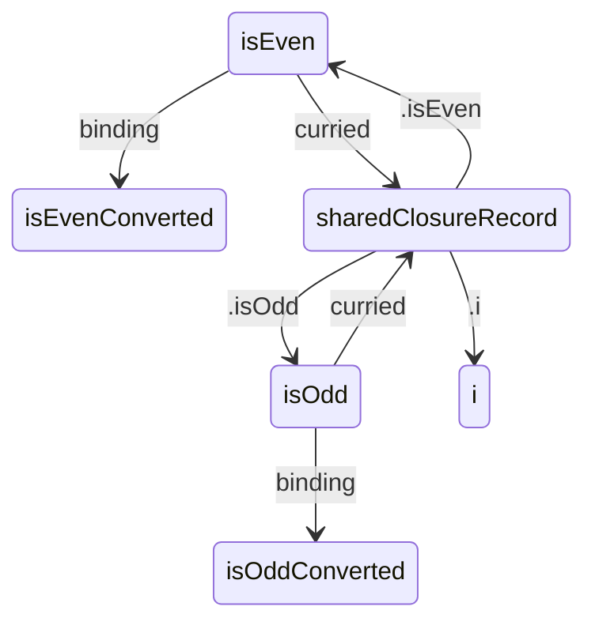

Notice the cycles: `isEven` points to `sharedClosureRecord` points back to `isEven`
and similarly for `isOdd`.

Here's an alternative, where named function declarations are not pre-computed
in `sharedClosureRecord`.  This approach is allowable in Temper because Temper
does not allow testing function reference identity; the fact that `isEven` bound
locally is not the same function value that `isOdd` calls recursively does not
matter to the semantics.  Function binding is side-effect free, so when and how
often it happens does not matter.

```patch
-// Naive rewrite.
+// Rewrite that allows coreferential named functions.
 function outer(wantEven, i) {
   // Original functions renamed and with references to closed-over
   // state rewritten to point to an extra closureRecord input.
   function isEvenConverted(closureRecord, j = closureRecord.i) {
     return j === 0 || closureRecord.isOdd(j - Math.sign(j));
   }
   function isOddConverted(closureRecord, j = closureRecord.i) {
     return j !== 0 && closureRecord.isEven(j - Math.sign(j));
   }

   // Declare the original names, and a closure record.
   // Curry the converted functions with the shared record to
   // get function values that have the same signature and semantics
   // as the originals.
   const sharedClosureRecord =
     {
+      get isEven() { return isEvenConverted.bind(sharedClosureRecord); };
+      get isOdd() { return isOddConverted.bind(sharedClosureRecord); };
     };
   const isEven = isEvenConverted.bind(sharedClosureRecord);
   const isOdd = isOddConverted.bind(sharedClosureRecord);
   // Initialize the closure record.
-  sharedClosureRecord.isEven = isEven;
-  sharedClosureRecord.isOdd = isOdd;
   sharedClosureRecord.i = i;

   let f = wantEven ? isEven : isOdd;

   return f;
 }
```

Changing binding named function declarations on demand leads to this
object graph, which lacks cycles.  (The cost of creating a bound
function on demand is low.  Python does it for every method call; it's
typically a pair of a pointer to the runtime's function definition
record and the closure record, so a short-lived two size\_t
allocation.)

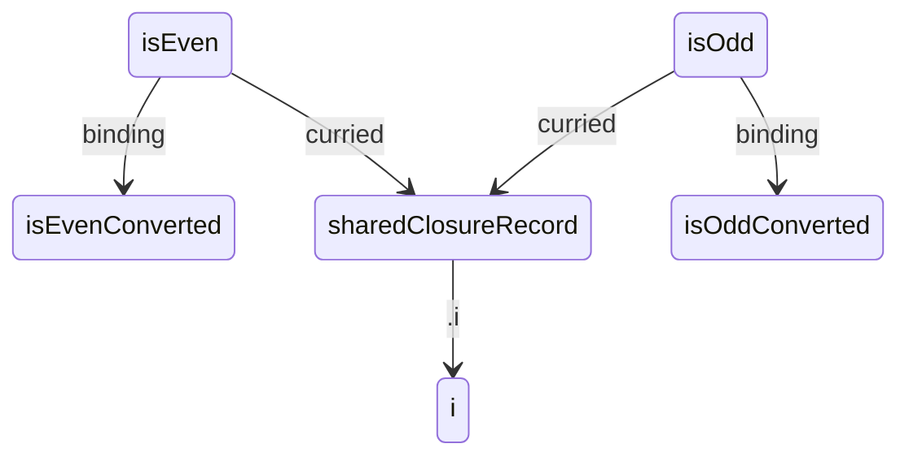

But if `var f`, the conditional function pointer,
was referenced by a converted inner function, then we would be in trouble again.
In the case where `f` points to `isEven`, we have this diagram.

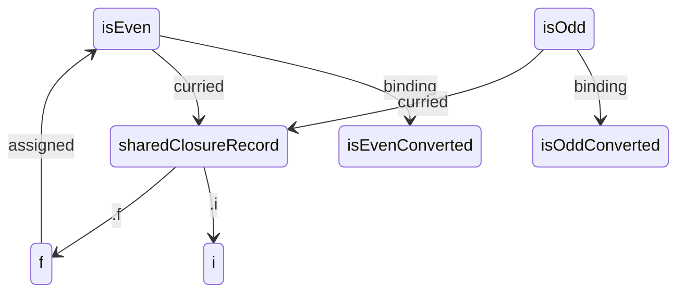

Rule: any function that closes over a local variable whose type is
either a function type that accepts that function
(pre-closure-conversion), or a super-type (*AnyValue*, *AnyValue\?*,
or that function type nullable) must be forbidden.

Similarly, if a function's type is reachable via assignment to a class instance field.

```ts
class Box<T forbids Box<T>>(public t: T) {}

let outer(): Void {
  let box: Box<fn (): Void>;

  let f(): Void {
    box.t();
  }

  box = new Box(f);

  f();
}
```

To check this, the best way is to simulate closure conversion with virtual, ad-hoc types.
`outer` includes a closure, so generate an ad-hoc class type for its closure record, and
another for each closure and turn the checkers loose on them.

```ts
// `box` is assigned after `f` captures it, so the record's property isn't
// early: a `<` edge.  A captured `let` that's set before any closure
// capturing it is made would be an early property: a `<=` edge.
class ClosureRecord#123(public var box: Box<fn (): Void>) {}

class BoundFunction#124(public boundParam0: ClosureRecord#123) extends fn (): Void {}
```

Now, the reasoning about what closure conversion could do becomes apparent,
and, since `class Box` forbids `<T>` from referring to `Box<T>`, the error analysis
should conclude that the responsibility for the problem is in the combination
of the closure record and the bound function, not in the definition of `Box`.
The message should say so in source terms, without naming the ad-hoc classes:
"`f` captures `box`, and `box.t` holds `f`", and suggest passing `box` to `f`
as an argument instead of capturing it.

Two things this example leaves open:

- By the forbids constraint checker as described, the type phrase
  `Box<fn (): Void>` fails on its own: `fn (): Void` is an open interface,
  so some other implementation of it could point to a `Box`.  See Open
  Issues.
- Methods and lambdas that capture `this` need the same treatment.  Storing a
  bound method like `this.onEvent`, or a lambda that uses `this`, in a
  property of `this` is a cycle.  Modeling them as ad-hoc classes with
  `this` as a captured property lets the same checks catch it.

We must also avoid using synthesized terms like `ClosureRecord#123` or `BoundFunction#124` in error messages, and instead store enough information so that those can be replaced with "Capture for f at file.temper.md:123".

[closure conversion]: https://matt.might.net/articles/closure-conversion/

### Forbids checking is contextual

```ts
class C<T>(
  public strings: List<String>,
) forbids List<T> {}

// Error: C<String> forbids List<String> but has a backed property that can
// point to a List<String>
let f(c: C<String>): Void {}

// Error: C's <T> binds to U but U does not forbid List<U>
let g<U>(c: C<U>): Void {}

// Ok: C's <T> binds to V which has compatible forbids
let h<V forbids List<V>>(c: C<V>): Void {}
```

(`String` stands in here for any type that `C` points to.)

This slight variant of it solves the problem in the class declaration.
Should Step V of the cycle checker algo realize that one of its forbids
can be parameterized to a super-type of one of its points-to types?
If so, we can avoid this at class check time and then rely on just checking
the validity of types like `c: C<String>` and sufficiency of forbids like `<U>`
missing a forbid of String when it is used in `C<U>`.

```ts
class C<T forbids String>(
  public strings: List<String>,
) forbids List<T> {}
```

Step V can find the condition.  When a reachable type, `List<String>`, and a
forbidden type, `List<T>`, differ only where the forbidden type mentions a
type formal, matching them gives the bindings under which they overlap:
here, `T` being bound to something whose values might be `String`s.  The
class is fine exactly when its type formals can't take those bindings.

Since a type formal's `forbids` clause means that it neither binds to nor
points to the forbidden type, `T forbids String` says exactly that: `T`
can't be bound to `String`, or to a super-type like *AnyValue*.  So the
variant solves the problem in the class declaration.  Step V accepts it,
and for the first version, it reports an error at the class that suggests
the bound.  After that, type phrases only need the usual check that type
arguments meet their bounds:

```ts
// Error: C's <T> forbids String, but String is a String
let f(c: C<String>): Void {}

// Error: C's <T> forbids String, but U might be one
let g<U>(c: C<U>): Void {}

// Ok
let h<V forbids String>(c: C<V>): Void {}
let k(c: C<Int>): Void {}
```

### Sealed interfaces

Interfaces are hard to reason about, but for sealed interfaces we can reason
about each direct sub-type individually without worrying about separately
constructed sub-types.

```ts
interface I {}

class C(
  public i: I
) {}
```

That fails because other code could theoretically construct a subtype
of I that allows for a cycle.

```ts
class ISub(public var c: C?) extends I {}

do {
  let isub = new ISub(null);
  let c = new C(isub);
  isub.c = c;
  // Now there's a cycle from c -> isub -> c
}
```

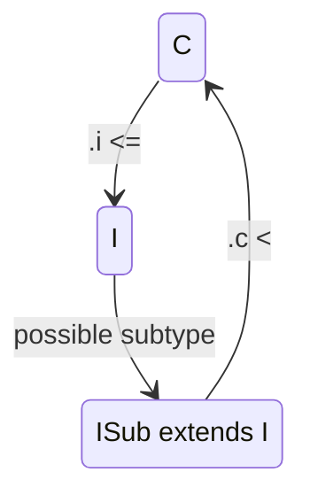

Here, the contradiction is *C* has to be less than itself because of the
`var` reference on the possible subtype of *I*.

But with `sealed interface`s, there are no *possible* subtypes that require
worst-case analysis; only the actual subtypes declared in the same module,
and their subtypes.

Here's an analogous case, *D* which points to an instance of a sealed interface, *J*.

```ts
class D(public j: J) {}

sealed interface J {}

class J1(public var s: String) extends J {}
class J2(public var n: Int64) extends J {}
class J3(public d: D?) extends J {}
```

Instead of having possible subtype relationships, we explode out all known variants.

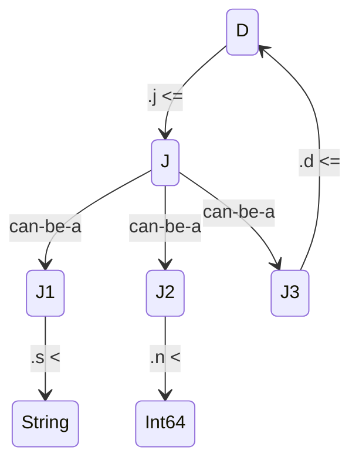

There's no contradiction.  Even though *J3* can point to a *D* and
vice versa, they are both via early, non-var properties which allows
for the temporal order property.  The cycle includes only `<=`
relationships, so there is no contradiction in the destructs-before
ordering.

### Forbidding interfaces

Sometimes we need `interface`s that aren't sealed and yet which we
collect over time.

For example, in a plugin module, we might want a universally extensible
interface.

```ts
class Messager(public subject: String) {
  private plugins: ListBuilder<MessagePlugin> = new ListBuilder<MessagePlugin>();

  public register(plugin: MessagePlugin): Void {
    plugins.add(plugin);
  }

  public printMessages(): Void {
    for (let plugin of plugins.toList()) {
      console.log(plugin.getMessage(subject));
    }
  }
}
```

But if anyone can construct a *MessagePlugin* subtype that refers back to
the *Messager* that owns them, then cycles are unavoidable.

```ts
interface MessagePlugin forbids Messager {
  getMessage(subject: String): String;
}
```

Here, the `forbids` clause on the `MessagePlugin` establishes that
its author restricts subtypes of it from pointing to a *Messager*:
*Messager* owns plugins, plugins don't own any *Messager*.

If a plugin author tried to do this then that would be a cycle type
definition checker error.

```ts
class BadMessagePlugin(public var messagers: List<Messager>) extends MessagePlugin {}
```

Here, the drop-order graph would look like this:

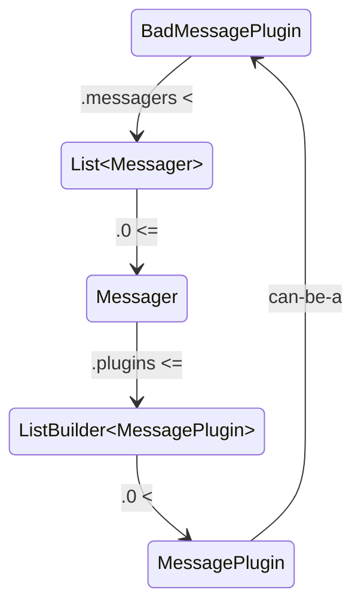

But *BadMessagePlugin* inherits a `forbids Messager` clause from its
supertype, so the edges `.messagers <` and `.0 <=` are illegal.

We're also allowed to use that fact to approve the *Messager* type.
We initially construct a drop-order graph that looks very similar,
but starting from *Messager* instead of *BadMessagePlugin*.

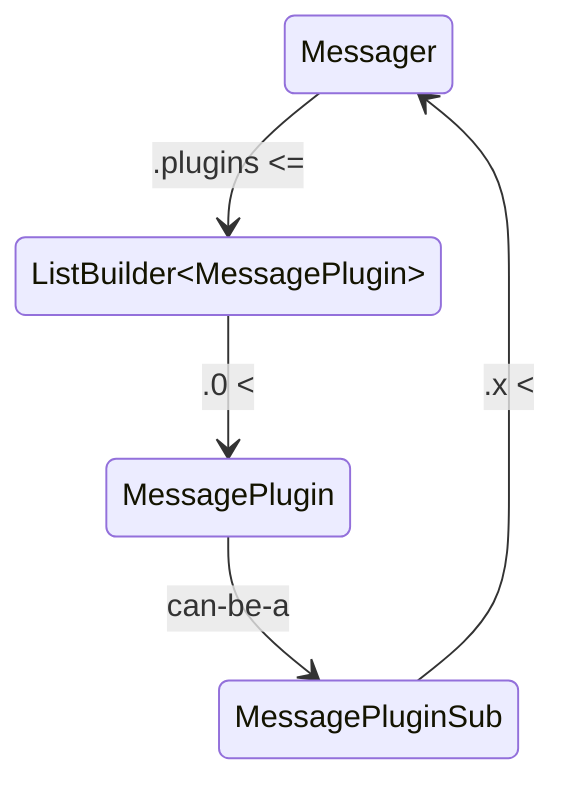

But we know our worst-case constructed *MessagePluginSub* is forbidden from
pointing (transitively) to *Messager*, so we can prune (see ❌ notation)
any of its outgoing edges that eventually lead to *Messager*.

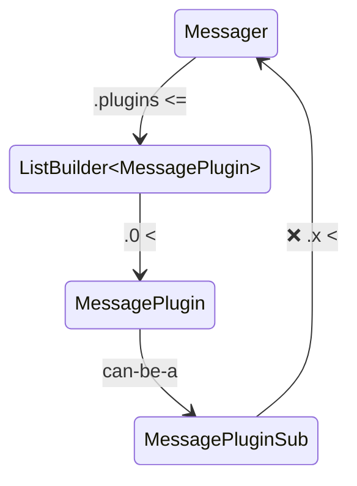

With those edges eliminated, we have this drop-order graph which is what is searched
for contradictory cycles starting at the subject, *Messager*.  No contradictions are found.

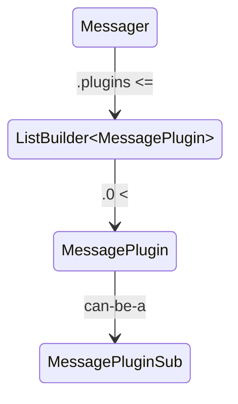

We also allow `forbids` clauses on `class`es, but since we know the actual backed
properties of every `class`, and Temper `class`es cannot have sub-types they are
less useful, except perhaps to document commitments not to evolve the `class` to
point to things in future versions.


## Scope bounded exceptions to the rule

```ts
let combine<T forbids List<T>>(a: List<T>, b: List<T>): List<T> {
  buildList { (builder) =>
    builder.addAll(a);
    builder.addAll(b);
  }
}
```

Here, the type formal `<T>` forbids `List<T>` but not `ListBuilder`.  The fact that
it uses a `ListBuilder` internally is an implementation detail that we might not
want to commit to forbidding, though, in this case, it's not problematic.

Can we use a `ListBuilder` or something equivalent internally?

What if we blessed certain classes as having a life-cycle where, if they progress
through their life-cycle, they are guaranteed not to participate in memory cycles.

Here's an example of how that might work in practice.

```ts
// After release, can point to nothing that might point back to it,
// and enters a zombie state where no new mutations can cause now
// back pointer paths.
interface PointsToNothingAfterRelease {
  release(): Void;
}


class LimitedTimeListBuilder<T> extends PointsToNothingAfterRelease {
  private released: Boolean = false;

  public add(el: T): Void {
    if (released) { return }
    ...
  }
  public addAll(els: Listed<T>): Void {
    if (released) { return }
    ...
  }

  public toList(): List<T> { ... }

  public release(): Void {
    // Flips bit so `add`s become no-ops.
    released = true;
    // Clears underlying content
    ...
  }
}

@inlineUnrealizedGoal
let buildList<T forbids List<T>>(f: fn (LimitedTimeListBuilder<T>): Void): List<T> {
  let b = new LimitedTimeListBuilder<T>();
  let ls: List<T>;
//try {
  f(b);
  ls = b.toList();
//} finally {
  b.release();
//}
  ls
}
```

Note, this *buildList* idiom could be improved by following on an
initiative to add `this` as inputs to block lambdas.

When a local declaration has a type that is a sub-type of *PointsToNothingAfterRelease*,
and it is const, and all paths downstream of its initializers lead to
a `.release()` of it (or of a variable that aliases it (possibly via `notNull(...)`))
then we can forego forbids-checking its type.  This doesn't solve the problem of
delegating building a list by passing the builder on.

(Temper has no `finally`, hence the commented-out `try` above, but hopefully that
problem will resolve.)

A released builder may still be referenced, but it points to nothing, so
storing it by mistake can't make a cycle.  That's why a release rule is
enough, without proving that the builder never escapes.

## Documentation

### New reference topic: Temper memory model

Temper needs to work in languages that do not have scanning garbage
collectors.  It needs to be able to prove that type definitions do not
lead to pointer reference cycles that prevent reference counting
pointers from deallocating memory when it's no longer useful to the
program.

_Cyclic Reference Counting with Permanent Objects_ by Lins et
al. explains a limitation of simple reference counting.


Temper provides two main mechanisms to allow for flexibility in
defining types while preventing memory leaks:

- A \[memory cycle checker\]\[snippet/memory-cycle-checker\] checks
  type definitions obey points to rules.
- Type definitions have \[`forbids` clauses\]\[snippet/forbids-clause\]
  which allow constraining what abstract types can point to.

\[inline memory-cycle-checker topic here]
\[inline forbids-clause topic here]

### New reference topic: Memory cycle checker

Temper's *memory cycle checker* checks each `class` declaration to
ensure that it: cannot point to itself via a chain of property
lookups.  In Temper, `interface`s can specify that subtypes need to
have properties but do not specify memory to hold pointers; only
`class`es do that.

If you write `class`es like OCaml records, things should just work:
concrete types that are shallowly immutable records that are
initialized at construction just work because of the *birth order principle*.

```ts
export class StringTree(
  public s: String,
  public left: StringTree?,
  public right: StringTree?,
) {}

export let myStringTree: StringTree = {
  s: "root",
  left: {
    s: "left leaf",
    left: null,
    right: null,
  },
  right: {
    s: "right leaf",
    left: null,
    right: null,
  },
};
```

That `class` definition refers to itself recursively but it cannot
have a memory cycle because each node is either `null` (which points
to nothing) or is older than the node that points to it.
That means that there is a well-known deallocation order: the root
will reach a reference count of zero and be eligible for deallocation
before its left and right, and when it is deallocated, its children's
reference counts will be decremented.

Sometimes types are naturally cyclic.  A graph consisting of *node*s and
*edges* might need to present an interface as-if nodes referred to
edges which could validly point back to that node.  "As-if" reference
does not require internal use of cyclic references.  Sometimes a managing
object can own pointers on behalf and use computed properties to present
a cyclic façade.

```ts
// Facades point to the owner but because they're
// created on demand, the owner does not point back.
// They use computed properties to present the state
// stores in the owner object as a convenient bundle.
class Node(
  private owner: Int32Graph,
  private nodeIndex: Int32,
) {
  public get value(): Int32 {
    owner.getNodeValue(nodeIndex)
  }
  public get outgoing(): List<Edge> {
    owner.getOutgoing(nodeIndex)
  }
  public get incoming(): List<Edge> {
    owner.getIncoming(nodeIndex)
  }
}

class Edge(
  private owner: Int32Graph,
  private fromIndex: Int32,
  private toIndex: Int32,
) {
  public get fromNode(): Node {
    owner.getNode(fromIndex)
  }
  public get toNode(): Node {
    owner.getNode(toIndex)
  }
}

// An adjacency table is a way of representing
// a complex a graph using a table where each
// row captures what is adjacent to one node.
class AdjEntry(
  public value: Int32,
  // These ints correspond to adjacent nodes.
  public outgoing: ListBuilder<Int32>,
  public incoming: ListBuilder<Int32>,
) {}


/** Stores ints at nodes and edges. */
export class Int32Graph {
  private adjacencyTable = new ListBuilder<AdjEntry>();

  // Adding nodes and edges would fill in that tables,
  // and could return facades that allow navigating the
  // graph.

  public getNode(index: Int32): Node {
    new Node(this, index)
  }

  public getNodeValue(index: Int32): Int32 {
    adjacencyTable[index].value
  }

  public getIncoming(index: Int32): List<Edge> {
    adjacencyTable[index].incoming.map { (i): Edge =>
      new Edge(this, i, index)
    }
  }

  public getOutgoing(index: Int32): List<Edge> {
    adjacencyTable[index].outgoing.map { (i): Edge =>
      new Edge(this, index, i)
    }
  }
}
```

The points-to relationships among these types are shown in this diagram.

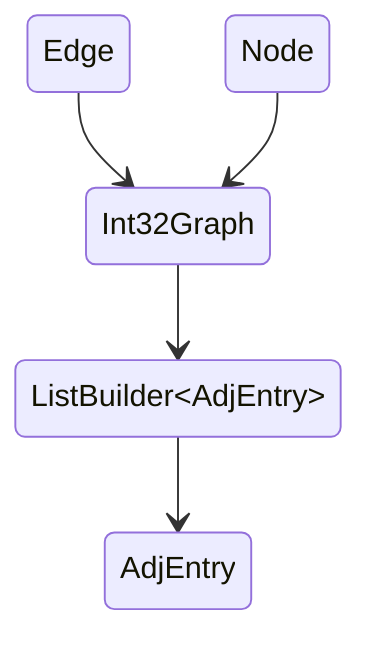

The façade types are constructed on demand, so they can point to the graph
object but are never pointed to by it and do not point to each other.

See \[`forbids` clauses\]\[snippet/forbids-clause\] for how this graph
might be made generic.


### New reference topic: `forbids` clauses

Inputs with types like `interface I` and `<T>` can have values of many
different concrete types assigned to them.  This means abstract types and
type variables enable many ways to produce reference cycles.  Without
some way to constrain them, they would be largely unusable in a language
that allows mutation, and disallows reference cycles.

```ts
do {
  let ls = new ListBuilder<AnyValue>();
  ls.add(ls);  // ls points to itself.
}
// FAILS: ListBuilder's <T> forbids ListBuilder<T>, so its elements mustn't
// be, or point to, a ListBuilder<T>, and an AnyValue could be either.
```

With `interface` types, it is often possible to construct a subclass
that points back to a class that uses the interface type for a backed property.

```ts
export interface I {}

// Each C points to I
export class C(public i: I) {}

// Some other library could define this class that points back.
export class IPointsBack(public var c: C?) extends I {}

do {
  let myI = new IPointsBack(null);
  let c = new C(myI);
  // The birth order principle does not apply because IPointsBack uses `var`.
  myI.c = c;
}
// FAILS
```

If you can, `sealed interface`s allow the memory cycle checker to avoid
constructing worst-case implementations of interface types.

But sometimes an `interface` is meant to allow external extensions.
One strategy for producing code that passes the memory cycle checker
is to layer types based on ownership and use `forbids` to enforce that.

```ts
// MessageMaker logs a message, and allows for extension via an interface.
export class MessageMaker(public greeted: String) {
  // helpers is mutable; anyone can implement a Helper and add to it.
  public helpers: ListBuilder<Helper> = new ListBuilder<Helper>();

  public sayMessage(): Void {
    var message = "Hello, ${greeted}!";
    for (let helper of helpers.toList()) {
      message = helper.modify(message);
    }
    console.log(message);
  }
}

// If a Helper could point back to a MessageMaker
// then there'd be no-way to compile this library without
// knowing about subclasses of `interface Helper` in all
// the libraries that could implement it.
export interface Helper
// This forbids clause means that every type assignable to
// a variable with type Helper must have the property that
// it does not (transitively) point to a MessageMaker.
forbids MessageMaker {
  modify(s: String): String;
}

do {
  class ReversingHelper extends Helper { // reversing "helper"
    public modify(s: String): String {
      var idx = s.end;
      let sb = new StringBuilder();
      while (idx > String.begin) {
        var before = s.prev(idx);
        sb.appendBetween(s, before, idx);
        idx = before;
      }
      sb.toString()
    }
  }
  let mm = new MessageMaker("World");
  mm.helpers.add(new ReversingHelper());
  mm.sayMessage();
}
```

The `forbids MessageMaker` allows `MessageMaker` to pass the memory
cycle checker by constraining the worst-case types that the cycle
checker has to construct to prove safety.
But it contributes extra checks to subtypes of `Helper` subclasses
which `ReversingHelper` passes because it does not point to a
`MessageMaker`.

### Added to documentation for `class` declarations

Classes that have generic type parameters, `<T>`, or which have
`var` backed properties need to take care to avoid
\[memory cycles]\[snippet/memory-cycle-checker].

Memory cycles prevent deallocation for target languages that do
not do scanning garbage collection.  If the compiler reports
memory cycle errors, see that topic for tips and tricks.

### Added to documentation for `interface` declarations

Interfaces provide abstraction, but that abstraction comes at a cost.
The \[memory cycle checker]\[snippet/memory-cycle-checker] might need
to make worst-case assumptions.  If the compiler reports
memory cycle errors, see that topic for tips and tricks.  Often
\[`forbids` clauses]\[snippet/forbids-clauses] help satisfy the compiler
that memory won't leak. Where possible, using a
\[`sealed` interface]\[snippet/sealed] helps the compiler avoid
worst-case reasoning.

## Effect on Backends

With this approach, references can be represented as reference-counting
smart pointers but they do not need to be.

This proposal does not assign semantics to when deallocation happens;
no RAII and no destructor effects.
Backends that assume the runtime provides a scanning garbage collector
can just leave all deallocation decisions to that garbage collector.
It is a goal of this approach that backends for the majority of modern
languages which fall in this category to be able to do nothing re
deallocation semantics, though we do need to enforce translatability
for all languages even when only building translations for
scanning-GC-using languages for the health of the Temper language community.

Backends for runtimes that do not provide either scanning or reference
counting garbage collection may have to implement reference counting
using manual techniques in library code.
The TmpL translator does not currently, but could support those
backends by allowing them to opt-into having increment/decrement
instructions inserted in TmpL.

## Open Issues

### `forbids` on properties initializers

Should we allow `forbids` on property metadata too, or more generally
on inputs and outputs?

```ts
class OwnerObject(
  public plugins: List<Plugin> forbids OwnerObject,
) {}

let makeOwnerObjectBad(p: Plugin): OwnerObject {
  new OwnerObject([p])  // ERROR: Plugin does not obviously forbid OwnerObject
}

interface FPlugin extends Plugin forbids OwnerObject {}

let makeOwnerObjectOk1(p: FPlugin): OwnerObject {
  new OwnerObject([p])  // FINE.  p forbids OwnerObject via FPlugin
}

let makeOwnerObjectOk2<P extends Plugin forbids OwnerObject>(p: P): OwnerObject {
  new OwnerObject([p])  // FINE.  p forbids OwnerObject via <P>
}
```

This may be a slippery slope towards `forbids` being a general type
operator which might explode the number of places where we need to
do forbids checking from type definitions and the set of distinct
type constructor instantiations to all assignable-to checks.

It might also raise the burden on code that constructs ASTs pre-typed
to also synthesize valid `forbids` info.

That last one shows a potential alternative way to achieve some of
those goals: `interface` types as inputs with their own `forbids`
clause smuggled via a type parameter.  Perhaps type parameters on a constructor
with forbids clause for early properties could contribute that those forbids
when propagating across the has-a edge for that property.

### a `forbids var` variant

Should `forbids` clauses be able to separately forbid any pointing-to
vs. pointing to via non-early reference?

It would be sound: `forbids var Y` would allow pointing to a `Y` only
through early properties, so a fake class's edge back to the main node
would become a `<=` edge instead of being pruned, and a contradiction
needs a `<` edge.

But it only helps when the owner reaches the interface through early
properties alone, i.e. holds it in a property set by its constructor.  Then
each implementation is older than its owner, and can point only to other,
older owners.  In the *Messager* example, the owner holds its plugins in a
*ListBuilder*, a `<` edge, so `forbids var Messager` would still leave a
contradiction.  Registries like that are the main reason for `forbids` on
open interfaces, so the plain clause seems enough for now.

### Open interfaces as type arguments

By the forbids constraint checker as described, `Box<fn (): Void>` fails
when `Box<T forbids Box<T>>`: some other implementation of the open
interface `fn (): Void` could point to a `Box`.  That makes function types,
and other open interfaces without matching clauses, unusable in generic
types with `forbids` clauses.

Are `forbids` clauses on `@fun interface`s sufficient to address this?

### Generators, `async` and promises

A suspended generator holds its frame, which acts like a closure record,
and callbacks registered on a `PromiseBuilder` can point back to whatever
holds the promise.  They need modeling, as ad-hoc classes like closures, or
`forbids` clauses on the core types.

Temper should provide a lifecycle close step.  Many coroutine schemes allow
for forcing a coroutine body to resume propagating failure so that normal
practices like releasing resources in `finally` clauses naturally lead to
resource release.  Something similar in Temper could allow us to avoid
memory leaks, optimistically assumign all coros progress towards completion
or close.

### Code the host supplies

The checker can't see inside `@connected` classes, or host implementations
of Temper interfaces like a clock, a source of randomness, or a session
store.  One option is to treat a `@connected` class as pointing to nothing
that Temper code can reach, and to document that host implementations must
keep the `forbids` clauses of the interfaces they implement.
